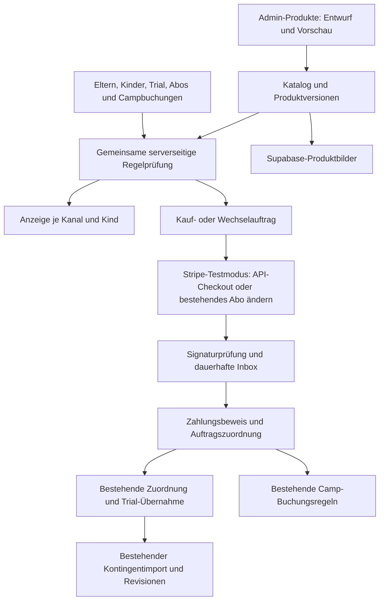

# ROAD-TO: Central Product Management 2.0

Stand: 25.10.2026 · Branch: `Produkte` · analysierter Ausgangsstand: `c883c89`.

**Status: Die lokale Umsetzung wurde im Chat ausdrücklich freigegeben und implementiert.** Den tatsächlichen Funktions-, Test- und Einschränkungsstand beschreibt [Produkte – lokale Umsetzung und Prüfbericht](docs/PRODUCT-MANAGEMENT-LOCAL.md). Die folgenden Analyseabschnitte dokumentieren den Ausgangszustand und die damaligen Umsetzungsvorschläge. Produktive Ressourcen wurden nicht geändert; kein Commit, Push, Merge oder Deployment.

## 1. Auftrag und Freigabegrenze

Fachliche Grundlage sind die beigefügte Aufgabenbeschreibung „ProAcademy – Central Product Management 2.0“ und die Bildreferenz mit zwei Ergänzungen:

- Kaufaktionen und Beschriftungen aus Produktart, ausgewähltem Kind und tatsächlichem Kundenstatus ableiten.
- Vor Änderungen veröffentlichter Produkte die Auswirkungen auf Anzeigeorte und berechtigte Familien aus der Datenbank berechnen. Die Beispielzahlen 18 und 42 sind keine Ausgangsdaten und werden nicht übernommen.

Diese Datei macht die geplante Umsetzung vor der Entwicklung prüfbar. Alle nachfolgenden neuen Tabellen, Endpunkte und Abläufe sind **Vorschläge**, keine bereits vorhandenen Funktionen. Die Architekturkonflikte in Abschnitt 16 benötigen eine Entscheidung vor den davon abhängigen Arbeiten.

Nach ausdrücklicher Freigabe erfolgt ausschließlich lokale Entwicklung mit isolierter Supabase-Instanz, erfundenen Familien und Stripe-Testobjekten. Eine Freigabe der lokalen Umsetzung autorisiert keine produktiven Zugriffe oder Veröffentlichung. Bestehende produktive Konfigurationen und andere Repositories bleiben außerhalb des Auftrags.

## 2. Analyseumfang und belastbare Grenzen

Untersucht wurden Quellcode, Datenbankmigrationen, Releases, vorhandene Tests, lokale Testskripte und die einschlägigen Repository-Dokumente. Maßgeblich ist der aktuelle Code einschließlich späterer SQL-Erweiterungen, nicht allein die ursprüngliche Schemafassung oder ältere Betriebsdokumentation.

| Bereich                      | Untersuchte Quellen                                                                                                                                                       | Befund                                                                                                                             |
| ---------------------------- | ------------------------------------------------------------------------------------------------------------------------------------------------------------------------- | ---------------------------------------------------------------------------------------------------------------------------------- |
| Adminprodukte und Navigation | `src/components/admin.tsx`, `src/components/admin-navigation.tsx`, `src/app/[[...section]]/page.tsx`                                                                      | `/admin/produkte` existiert als generischer Tarifeditor; kein zentraler Shopkatalog.                                               |
| Produkt-API und Eingaben     | `src/app/api/[...path]/route.ts`, `src/lib/server/schemas.ts`                                                                                                             | Adminrollenprüfung, Zod und RLS vorhanden; `plans` wird generisch gelesen und geschrieben.                                         |
| Tarife und Kontingente       | Migrationen 001, 005, 006; `docs/TARIFF-RULES.md`; `src/lib/domain.ts`, `src/lib/training-period.ts`                                                                      | Preisgebundene Tarifvarianten, Bestandsregeln, Monats-/Jahreslogik und historische Snapshots bestehen.                             |
| Stripe                       | `src/lib/server/stripe.ts`, `stripe-preview.ts`, `profile-stripe.ts`, `src/lib/family-accounts.ts`                                                                        | Signierte Inbox, Subscription-/Item-Sync, Rechnungsimport und Familienzuordnung vorhanden. Kein allgemeiner API-Checkout-Erzeuger. |
| Tarifwechsel                 | Releases 011, 014, 015; `src/lib/server/subscription-reviews.ts`; `src/components/subscription-reviews.tsx`                                                               | Verarbeitung und Zuordnungsprüfung bereits erfolgter Stripe-Wechsel; keine elterliche Wechselvorschau/-bestätigung.                |
| Eltern, Kinder, Rollen       | Familienmigration 009, Single-Parent-Migration 013, Elternprofilmigrationen; `src/lib/server/parent-profile.ts`, `supabase.ts`, `security.ts`, `src/lib/portal-access.ts` | Mehrere Kinder und Stripe-Kunden pro Elternkonto; aktuell genau ein Elternkonto je regulärem Kind.                                 |
| Probetraining                | Releases 017–021; `src/lib/trials/*`; Trial-API und -Komponenten; `docs/PROBETRAINING.md`                                                                                 | Getrennte Trial-Kinder, echte Auth-Verknüpfung, Mischfamilien, transaktionale Abo-Übernahme und Camp-Identitätsbrücke vorhanden.   |
| Camps                        | `src/lib/camps/*`, Camp-API/-Webhook, `supabase/camp/001` bis `013`, Camp-Komponenten                                                                                     | Buchung, Preis-/Rabattprüfung, Kapazität, Zahlungsbeweis, Import und Berichte vorhanden; Checkout basiert auf Payment Links.       |
| Storage und Schutz           | Basismigration, `service-db.ts`, `next.config.ts`, `src/proxy.ts`, Plattformmigration/-Service                                                                            | Privater Berichts-Bucket; keine Produktbildverwaltung. CSP erlaubt derzeit keine direkten externen Bildquellen.                    |
| UI und Testbetrieb           | `src/app/globals.css`, Modal/Badge in `portal.tsx`, `tests/*`, `scripts/local-family-test/*`, `scripts/local-trials/*`                                                    | Design-Tokens, Dialogzugänglichkeit, PGlite, Playwright, Kontowechsel und Netzsperre wiederverwendbar.                             |

Installiert sind Next.js 16.3.8, React 19.2, Stripe SDK 18.5, Supabase JS 2.57 und Zod 4. Die lokalen Next-Leitfäden zu Route Handlers und Bildoptimierung unter `node_modules/next/dist/docs/` wurden gelesen. Vor späteren Codeänderungen werden die jeweils betroffenen lokalen Leitfäden erneut gezielt geprüft; keine Annahmen aus älteren Next-Versionen übernehmen.

Nicht geprüft wurden produktiver Datenbestand, aktuelle Stripe-Objekte, tatsächliche Kontoberechtigungen, laufende lokale Dienste oder der separate Homepage-Quellcode. Es wurden keine Secrets aus `.env.local` oder privaten Sicherungen gelesen. Die historischen Produkt-IDs in Migration 006 beweisen keinen aktuell gültigen Testkatalog. Bestehende Testberichte sind Hintergrundinformationen, keine in diesem Auftrag neu ausgeführten Testnachweise.

## 3. Ist-Zustand und wiederverwendbare Funktionen

### 3.1 Produktverwaltung und Datenmodell

Der Editor in `admin.tsx` pflegt `plans.name`, `stripe_price_id`, `generation`, `billing_interval`, `included_units` und `athletics_units`. Das Schema erlaubt dort nur FirstTouch, GameChanger, Pro-Player und NEXT LEVEL. Eine Price-ID wird lediglich auf das Präfix `price_` geprüft; Preis, Product, Aktivität und Intervall werden im Editor nicht von Stripe validiert.

Die allgemeine Admin-API kennt einen Offset und liest jeweils 100 Datensätze. Der Produktbildschirm lädt eine Seite und filtert diese lokal mit `JSON.stringify`. Es gibt dort keine vollständige serverseitige Produktsuche oder Bedienung aller Folgeseiten. Eine Seitengröße ist sinnvoll; eine Begrenzung des gesamten Katalogs auf die geladene Seite ist es nicht.

`plans` ist zugleich fachlicher Tarifkatalog des Kontingentimports:

- `stripe_price_id` ist eindeutig; derselbe Tarifname kann mehrere Bestands-/Neupreisvarianten haben.
- Die Constraint `plan_allowances` bindet Namen, Kontingent, Tarifgeneration und Zahlungsintervall an bestätigte Regeln.
- `legacy_private` verbietet öffentliche Bestandstarife.
- `active` wird von `import_stripe_allowance` und Zuordnungsprüfungen ausgewertet. Es ist kein bloßes Shop-Sichtbarkeitsflag.
- Das Camp-Schema ergänzt `is_camp`, `camp_id` und `camp_benefit_percent`. Camp-Pläne haben null Trainingskontingent und bleiben vom Aboimport getrennt.
- `entitlement_periods` speichert Preis, Produktname und Kontingente als fachliche Momentaufnahme. Abgeschlossene Perioden und Berichtsversionen bleiben geschützt.

**Folgerung:** Beliebige Shopnamen und Produkte lassen sich nicht sicher durch Lockerung aller `plans`-Constraints ergänzen. Ebenso darf „im Shop deaktivieren“ kein bestehendes Abo aus dem Kontingentimport entfernen.

### 3.2 Stripe, Familien und Zahlung

`stripeClient()` hält Keys serverseitig und sperrt Livekeys außerhalb von `APP_MODE=production`. `verifyStripe()` prüft den Rohbody; `persistStripeEvent()` dedupliziert Events. `processStripeInbox()` ruft den aktuellen Stripe-Zustand ab und verwendet `apply_stripe_package_sync`. Historische bezahlte Rechnungszeiträume laufen durch `syncInvoicePeriods()` und `import_stripe_allowance()`.

Das reicht noch nicht als Kaufabschluss: Ein `checkout.session.completed` stößt bisher primär einen Subscription-Sync an. Eine vollständige, zahlungsbestätigte Bestellung mit Produktversion, ausgewähltem Kind und verbindlicher Zuordnung fehlt. Zudem können aktive/trialing Subscriptions im bestehenden Sync Kontingente erzeugen; für neue Käufe muss daher auch die **Zuordnung** bis zum verifizierten Zahlungsabschluss zurückgehalten werden. Ein Erfolgsredirect darf keine Aktivierung auslösen.

`POST /api/stripe/portal` prüft die Sitzung und eigene `parent_stripe_customers`, verlangt bei mehreren Kunden eine Auswahl und öffnet das konfigurierte Stripe-Kundenportal. Dies wird für Rechnungen und Zahlungsmittel erhalten. Eine dort mögliche Tarifwechselfreigabe hängt von der externen Portal-Konfiguration ab und wurde nicht verifiziert; sie darf die neuen Produktregeln später nicht umgehen.

`link_stripe_family`, `sameFamilyContact`, `selectBillingCustomer` und `subscriptionLinkIssue` bieten wiederverwendbare Prüfungen für Customer, Subscription, Item, Elternkonto und Kind. Die Zuordnung beruht auf expliziten Identitäten; Rechnungs-E-Mail ist keine Zugangsberechtigung. `parent_stripe_customers` hat nur eine kombinierte Eindeutigkeit auf Elternkonto und Customer, keine globale auf Customer allein. Neue Kaufwege müssen bestehende Mehrdeutigkeiten erkennen und ablehnen, statt eine zusätzliche globale Constraint ungeprüft einzuführen.

Die aktuelle Single-Parent-Migration erzwingt genau ein Elternkonto pro regulärem Kind. Ältere README-Aussagen über mehrere Elternzugänge sind dadurch überholt. Unterschiedlicher Zahler und Erziehungs-/Portalzugang bleiben getrennte Konzepte.

### 3.3 Tarifwechsel

Release 011 ergänzt `apply_stripe_package_sync`, `entitlement_package_revisions` und `subscription_assignment_reviews`. Eindeutige Item-Ersetzungen werden verarbeitet, mehrdeutige Fälle zur Bestätigung vorgelegt. Releases 014/015 erweitern Prüfungsverlauf und bestätigte Bestandsausnahmen. Laufende Kontingente können über kontrollierte Revisionen wechseln; historische Zeiträume, angerechnete Einheiten und getrennte Athletik bleiben erhalten.

Im Anwendungscode wurde kein allgemeiner Aufruf zum Erzeugen von Checkout Sessions, kein elterlicher `subscriptions.update`-Ablauf und keine Prorationsvorschau gefunden. Benötigt wird eine neue Orchestrierung um die vorhandene Kontingent-/Zuordnungslogik. Die Auswahl zwischen Upgrade, Downgrade und Zusatzvertrag darf nicht allein aus einem höheren Eurobetrag folgen.

### 3.4 Probetraining 017–021

| Release | Für Produkte wesentliche Verantwortung                                                                                                         |
| ------- | ---------------------------------------------------------------------------------------------------------------------------------------------- |
| 017     | Trial-Familien/-Anfragen/-Feedback, Teilnahmebezug, öffentliche Anfrage und Nachrichten.                                                       |
| 018     | Separate `trial_players`, Auth-Verknüpfung, `trial_convert_for_review` und transaktionaler Wrapper um `resolve_subscription_assignment`.       |
| 019     | Verschärfte Identitäts-/Freigaberegeln, einmalige Zugänge, Familienstatus, Aufbewahrung, Folgekommunikation und Übernahmeprüfungen.            |
| 020     | Campzugang mit derselben Kinder-UUID, `camp_player_id`, Profilsynchronisierung, angepasste Übernahme und Bereinigung unbezahlter Campentwürfe. |
| 021     | Verbindliche Freigabe über `platform_features.trial_training` statt altem Staging-Schalter.                                                    |

Die neueste Definition von `trial_convert_for_review` aus 020 bewahrt ein vorhandenes Camp-Profil und übernimmt genau dieselbe UUID. `resolve_subscription_assignment` führt Übernahme und fachliche Abo-Zuordnung in einer Transaktion aus. Bei Fehlern werden beide zurückgerollt. Feedback und Campbuchungen bleiben damit zugeordnet.

**Konflikt:** Diese Übernahme verlangt derzeit `is_admin()` und eine passende offene Zuordnungsprüfung. Ein Service-Role-Job erfüllt die Adminprüfung nicht automatisch. Ein Eltern-Checkout kann diese Routine deshalb nicht unverändert direkt ausführen. Keine Adminidentität im Hintergrund vortäuschen und keine zweite Übernahmelogik bauen.

`trial_account_state()` liefert einen nützlichen Navigationsstatus, aber keine vollständige Kaufberechtigung: Der Status berücksichtigt auch historische reguläre Zuordnungen; „subscriber“ ist daher kein Nachweis eines aktuell bezahlten Abos. Die Produktprüfung benötigt genauere Daten pro Kind und Item. Identitätsprüfung und Übernahme müssen auch bei ausgeschaltetem Trial-Menü erhalten bleiben.

### 3.5 Camp-System

`createBooking`, `childBenefit`, `confirmPayment`, `camp_confirm_payment` und spätere Import-/Genehmigungsroutinen enthalten wichtige bestehende Regeln für Alter, Termine, Kapazität, Rabatt, Identitäten und verifizierte Zahlung. Diese Regeln werden weiterverwendet.

Der heutige Weg validiert oder erzeugt Payment Links und hängt Buchungsreferenz und E-Mail an deren URL. `camp_offers`, `camp_bookings`, Zahlungsbestätigung, Webhook-Quellenerkennung und Reconciliation erwarten Link-IDs. `campReadStripe()` sowie die bestehende automatische Camp-Inbox sind ausdrücklich auf Live-Lesezugänge bzw. Live-Events ausgerichtet. Diese Verarbeitung ist kein geeigneter Test-Checkout-Worker und wird in der Produkt-Testumgebung nicht gestartet.

Ein API-Checkout für neue Camps braucht deshalb einen ausdrücklich gekennzeichneten neuen Zahlungsursprung und einen Adapter auf die bisherigen Prüf-/Buchungsroutinen. Ein API-Checkout hat keine Payment-Link-ID; eine erfundene Ersatz-ID würde die Beweiskette beschädigen. Historische Linkbuchungen und deren Verarbeitung bleiben kompatibel.

### 3.6 Storage, Schutz und UI

Es gibt einen privaten Supabase-Bucket `reports` mit kontrolliertem Download. Dieser wird nicht für Produktbilder umgewidmet. Neue Bilder benötigen eigene Metadaten, Zugriffsregeln und Bereinigung. Die CSP in `next.config.ts` erlaubt aktuell nur `self`, `data:` und `blob:` als Bildquellen. Remote-Bilder brauchen daher eine gezielte Lösung; ein beliebiges Öffnen von `img-src` ist nicht erforderlich.

Wiederverwendbar sind `sessionUser`, `assertRole`, `requireOrigin`, Zod, RLS, Audit-Trigger und private `no-store`-Antworten. Service-Role-Zugriffe müssen explizite Objektberechtigungen behalten. Der zentrale Funktionsschalter hat eine zusätzliche Berechtigung `manage_features`; diese ist kein allgemeines Produktbearbeitungsrecht.

Das Design liefert Dunkelblau `#0b0f1a`, Lime `#8eff01`, Violett `#8b53fe`, Flächen-/Linien-Tokens und bestehende Buttons, Panels, Badges und Modals. Das vorhandene Modal unterstützt Fokusführung, Escape und Fokusrückgabe. Darauf aufbauen und für neue Auswahl-/Sheet-Interaktionen gezielt prüfen. Keine zusätzliche UI-Bibliothek nötig.

## 4. Zielarchitektur und Abhängigkeiten

Empfohlen wird eine **additive Katalogschicht über den bestehenden Fachmodellen**. `plans` bleibt verbindlich für Aboansprüche, `camps`/`camp_offers` bleiben verbindlich für Campdaten. Die zentrale Produktverwaltung bündelt Darstellung, Veröffentlichung und Regeln, ohne die Fachmodelle zu duplizieren.

Die Produktfunktionen erhalten getrennte Module für Katalog, Policy, Kontextauflösung, Bilder, Stripe-Prüfung, Kauf und Wechsel. Vorgesehene Orte: `src/lib/products/`, `src/lib/server/products/`, `src/components/products/` und explizite App-API-Routen. Die exakten Dateinamen werden erst bei der Umsetzung festgelegt.

Abhängigkeiten und Reihenfolge:

1. Vollständiges lokales Basisschema einschließlich Elternprofile, Camp 001–013 und Releases 011/014/015/017–021; Abhängigkeiten aus den vorhandenen Trial-Datenbanktests übernehmen.
2. Additiver Katalog mit klarer Trennung von Verkaufsstatus und Fachplanaktivität.
3. Serverseitiger Kontext und gemeinsame Policy für Liste, Vorschau, Checkout und Nutzung.
4. Admineditor, Bilder und Änderungsvorschau auf dieser Policy.
5. Zahlungsauftrag, Test-Checkout und verifizierte Abschlussverarbeitung.
6. Trial-Automatisierung erst nach Entscheidung zum Adminkonflikt; Camp-API-Checkout nach Entscheidung zum Zahlungsadapter.
7. Eltern-Tarifwechsel mit derselben Auftrags-/Zahlungsbasis und bestehenden Kontingentrevisionen.
8. Vollständige lokale Abnahme. Homepage-Konsument bleibt zunächst nur eine vorbereitete Schnittstelle.

`loadPortal()` lädt heute umfangreiche Trainings-/Berichtsdaten. Die neue Produktseite sollte nach dem vorhandenen `profileShell`-Muster nur die benötigte Hülle und ihren eigenen paginierten Loader verwenden. Kein vollständiges Laden aller Familien oder Produkte beim Seitenaufruf.

## 5. Datenmodell und begründete Erweiterungen

### 5.1 Empfohlenes additives Schema

Die folgenden Namen sind vorläufig. Jede neue Relation erhält RLS, minimale Grants, Audit und geeignete Indizes. Zusammenlegbare Metadaten bleiben zusammen; es wird kein generisches Shop-/CRM-System auf Vorrat gebaut.

| Relation/Erweiterung        | Inhalt                                                                                                                                                                                                                                     | Warum vorhanden nicht ausreichend ist                                                                                                                                |
| --------------------------- | ------------------------------------------------------------------------------------------------------------------------------------------------------------------------------------------------------------------------------------------ | -------------------------------------------------------------------------------------------------------------------------------------------------------------------- |
| `catalog_products`          | Stabile UUID, interner Name, Produktart, Kategorie, Revision und Verweis auf aktuelle veröffentlichte Version.                                                                                                                             | `plans` hat fachlich gebundene Namen/Kontingente; beliebige Camps und sonstige Produkte passen nicht in ein Abo-Fachmodell.                                          |
| `catalog_product_versions`  | Anzeigename, Lang-/Kurzbeschreibung, Sortierung, Hervorhebung, Status, Veröffentlichungs-/Ablaufzeit, Anzeigeorte, drei getrennte Regelbäume, Stripe-Prüfsnapshot und exakte Fachreferenzen. Entwurf und veröffentlichte Version getrennt. | Änderungen sollen vor Veröffentlichung vollständig geprüft werden, ohne die gerade aktive Fassung umzuschreiben. Audit allein liefert keinen veröffentlichten Stand. |
| `catalog_product_assets`    | Produkt-/Versionsbezug, Storage-Pfad, Hauptbild/Galeriesortierung, Alttext, Bildmaße, Typ, Bytes, Hash und Freigabestatus.                                                                                                                 | `report_files` gehört unveränderlichen privaten PDFs; keine sichere Bildreferenz- oder Löschverwaltung vorhanden.                                                    |
| `catalog_product_grants`    | Individuelle, befristete Freigabe für Auth-Nutzer, Elternkonto oder Kind; Regelzweck und Begründung.                                                                                                                                       | Keine vorhandene Relation trennt individuelle Sicht-, Kauf- und Nutzungsfreigaben.                                                                                   |
| `product_purchase_intents`  | Produktversion, Modus, Eltern-/Kinderreferenz, Zahlkonto, Idempotenz, Session-/Subscription-/Item-IDs, erwarteter Preis/Währung, Status und Zahlungsbelegreferenzen.                                                                       | Stripe-Inbox enthält Ereignisse, aber keine verbindliche Kaufabsicht und Kind-Zuordnung.                                                                             |
| `product_purchases`         | Eindeutiger erfüllter Auftrag und Nutzungsnachweis für sonstige Produkte; referenziert bei Abo/Camp die vorhandenen Fachobjekte.                                                                                                           | Sonstige Einmalprodukte haben bisher keinen Nutzungsnachweis. Abo-/Camp-Rechte bleiben aus den Fachobjekten abgeleitet.                                              |
| `product_change_requests`   | Ausgangs-/Zielversion, bestehendes Abo/Item/Kind, Preisvorschau, Ausführungszeit, Bestätigung und Zustand.                                                                                                                                 | Paketrevisionen dokumentieren Kontingentfolgen, aber keine vom Elternkonto autorisierte Stripe-Änderung.                                                             |
| Gezielte Camp-Erweiterungen | Zahlungsursprung `api_checkout`, optionaler Linkbezug für neue Buchungen, eindeutiger Session-/Intent-Bezug und unveränderlicher Angebotsnachweis.                                                                                         | Das aktuelle Schema und dessen Prüfroutinen verlangen Payment-Link-IDs. Bestehende Ursprünge behalten ihre bisherigen Pflichtfelder.                                 |

Für Abos referenziert die Produktversion einen eindeutigen `plan_id`; die Stripe Price-ID muss dazu passen. Für Camps referenziert sie ein konkretes Campangebot einschließlich Normal-/Frühbuchervariante. Sonstige Einmalprodukte benötigen keinen künstlichen `plans`-Datensatz. Kein zweiter frei editierbarer Preis neben der Stripe-Quelle.

Eine veröffentlichte Version enthält genau eine kaufbare Price-ID. Weitere Preise eines Produkts werden als getrennte Angebotsvarianten mit eindeutiger Zuordnung behandelt; alte Versionen bewahren die frühere Zuordnung. Pro Fachangebot/Price und Umgebung zunächst eine kanonische Produktzuordnung vorsehen, um Doppelanzeigen und mehrdeutige Abschlüsse zu vermeiden. Falls mehrere Marketingkarten für dasselbe Angebot erwünscht sind, ist dies separat zu entscheiden.

### 5.2 Zustände, Historie und Indizes

- Produktarten: `subscription`, `camp`, `other`; Bezeichnungen Abonnement, Camp, Sonstiges.
- Verkaufszustände: `draft`, `active`, `internal`, `exclusive`, `sold_out`, `archived`.
- Neue Produkte sind zunächst Entwurf ohne öffentliche Kanäle oder Kaufrechte. Aktivierung verlangt vollständige Fachreferenz, gültige Stripe-Prüfung und Regeln.
- Veröffentlichung und Ablauf als UTC speichern, im Editor ausdrücklich mit `Europe/Berlin` anzeigen; bestehende fachliche Zeitzone nicht durch die Gerätezeitzone ersetzen.
- Anzeigename ändern heißt keine Umbenennung historischer Leistungszeiträume. Ein Kontingentwechsel bleibt ein eigener fachlicher Vorgang.
- Shop-Deaktivierung/Archivierung ändert weder `plans.active` noch Stripe Product/Price noch bestehende Verträge. Regulärer Synchronisationsimport bleibt verfügbar.
- Regelbäume werden als versioniertes, strikt validiertes JSON gespeichert. Keine frei ausführbaren SQL-Ausdrücke und keine untypisierten Zielgruppenstrings.
- Serverindizes für Status, Art, Kategorie, Kanal, Veröffentlichungszeit und stabile Sortierung; Suche über normalisierte Namen/Beschreibungen. Geeigneten Suchindex anhand der lokalen Abfragepläne auswählen.
- Cursor für Produktlisten nach einer stabilen Kombination wie Sortierung und UUID; bei Suche Cursor an Filter und Sortierdefinition binden. Seitengröße begrenzen, vollständigen Durchlauf nicht begrenzen.
- Kaufaufträge mit eindeutiger Request-ID, Stripe-Session und erfülltem Auftrag; zusätzlich eine Datenbanksperre für gleichzeitig offene Abo-Käufe/Wechsel desselben Kindes. Stripe-Idempotenz allein schützt keinen zweiten Request mit neuer UUID.
- Reservierte Neukunden-Kinder-UUID vor Zahlung ist noch kein aktives Spielerprofil. Unbezahlte Reservierungen mit kurzer Aufbewahrung bereinigen; keine dauerhafte Dublettensperre aus unbezahlten Formulareingaben.

## 6. Zielgruppen und Berechtigungslogik

### 6.1 Tatsächlicher Kontext statt einzelner Nutzerstatus

Ein serverseitiger Resolver bildet den authentifizierten Nutzer, sein nicht archiviertes Elternkonto, alle regulären und Trial-Kinder, bestätigte Familienverknüpfungen, zugehörige Abos/Items, Leistungszeiträume, Campbuchungen und individuelle Freigaben ab. Die Zusammenführung von `players` und `trial_players` dedupliziert nach UUID; ein Camp-Profil bedeutet keine Abo-Übernahme.

Familie bedeutet hier das autorisierte Elternkonto mit seinen Kindern, nicht gemeinsame Nachnamen oder Rechnungsadressen. Stripe-Beziehungen werden nur über bestätigte Verknüpfungen genutzt. Bei mehreren Zahlkonten muss die Auswahl eindeutig sein; ein anderes Zahlkonto verleiht keine Kinderrechte.

Vorgeschlagene Zielgruppensemantik:

| Zielgruppe                                       | Serverseitiger Nachweis                                                                                                                                                             |
| ------------------------------------------------ | ----------------------------------------------------------------------------------------------------------------------------------------------------------------------------------- |
| Alle                                             | Wahr innerhalb des geprüften Kanal-/Lebenszykluskontexts; hebt keine weiteren Sperren auf.                                                                                          |
| Besucher                                         | Keine authentifizierte Sitzung; keine Aussage über bereits bestehende Kundenidentität.                                                                                              |
| Neukunden                                        | Nach Identitätsprüfung keine frühere oder aktuelle Mitgliedschaft, Trial- oder bestätigte Campbeziehung im maßgeblichen Kontext. Ein neuer Browser allein genügt nicht.             |
| Probetraining-Kunden                             | Nicht übernommenes Trial-Kind in einer noch gültigen, nicht beendeten Trial-Familie. Teilnahmezustand zusätzlich als Merkmal verfügbar.                                             |
| Ehemalige Probetraining-Kunden                   | Nachweislich beendeter Trialbezug ohne laufenden Trialstatus; nur solange dieser Nachweis gemäß Aufbewahrung noch existiert. Nach 180-Tage-Löschung nicht dauerhaft rekonstruieren. |
| Abo-Kunden                                       | Eindeutig zugeordnetes, aktuell leistungsberechtigtes Abo; Payment-/Reviewzustände gesondert berücksichtigen.                                                                       |
| FirstTouch / GameChanger / ProPlayer / NextLevel | Genaues aktuelles Price-/Plan-/Item-Mapping, normalisiert auf den fachlichen Tarifschlüssel; kein Vergleich allein mit Anzeigenamen.                                                |
| Ehemalige Abonnenten                             | Belegte frühere Abozuordnung ohne aktuell berechtigtes Abo im gewählten Kontext. Ein fremdes Geschwisterabo ändert nicht den Kindstatus.                                            |
| Camp-Kunden                                      | Bestätigte, fachlich gültige Buchung; unbezahlter Entwurf genügt nicht. Vollständig erstattete/streitige Zahlungen nach bestehender Campregel behandeln.                            |
| Interne Nutzer                                   | Verifizierte Rolle staff/admin; kein automatisch gewährtes Kaufrecht für beliebige Kinder.                                                                                          |
| Individuell freigegebene Nutzer                  | Passende, nicht abgelaufene Freigabe für den jeweiligen Regelzweck und autorisierten Kontext.                                                                                       |

Offene Zahlungen, `past_due`, `incomplete`, `needs_review` und Kündigung zum Periodenende nicht pauschal als „ehemalig“ behandeln. Für den Wechsel zunächst sperren bzw. Klärung verlangen; Nutzungsrechte weiter aus bestehenden Leistungsregeln ableiten. Eine Stripe-Test-Subscription `trialing` ist außerdem kein ProAcademy-Probetraining und erfüllt nicht automatisch die neue Forderung nach bestätigter Erstzahlung.

### 6.2 Drei getrennte Entscheidungen

Eine gemeinsame Policy liefert drei voneinander getrennte Ergebnisse:

1. **Sichtbarkeit:** Darf die Produktkarte im konkreten Kanal erscheinen?
2. **Kaufberechtigung:** Darf dieser Akteur dieses Produkt für dieses Kind mit diesem Kaufmodus erwerben?
3. **Nutzungsberechtigung:** Besteht für dieses Kind eine erworbene und fachlich noch gültige Leistung?

Nicht sichtbar bedeutet nicht automatisch nicht nutzbar: Ein später archiviertes Angebot entzieht keinem Kind eine bereits erworbene, weiterhin gültige Leistung. Umgekehrt ersetzt eine sichtbare Karte keinen Kaufnachweis. Bestehende Abo-/Camprechte bleiben verbindlich; zukünftige Regeländerungen widerrufen sie nicht beiläufig.

Regeln unterstützen `any` (ODER), `all` (UND), Ausschlüsse und expliziten Bezug `family` oder `player`. Bedingungen desselben spielerbezogenen UND-Blocks müssen für **dasselbe ausgewählte Kind** gelten. Familienweite Aussagen dürfen ausdrücklich verschiedene Kinder einschließen, erteilen aber keine automatische Kaufberechtigung für ein anderes Kind. Ausschlüsse und Lebenszyklussperren haben Vorrang vor individuellen Freigaben.

Beispiel: Kind A hat GameChanger, Kind B ein offenes Probetraining. Die Familie erfüllt „hat Abo“ und „hat Trial“. Für Kind B kann „Mitglied werden“ zulässig sein; Kind A erhält eine Wechselprüfung. Kind B wird nicht durch das Geschwisterabo als bereits gebucht eingestuft.

Jede Entscheidung enthält Ergebnis, erlaubte Kaufmodi, verständliche Gründe mit stabilen Fehlercodes, Kind-ID, erkannte Merkmale, Produktrevision und Prüfzeit. Vorschau, Liste und Kauf verwenden dieselbe Policy. Bei unvollständigen Daten: keine positive Berechtigung behaupten, insbesondere keine Kaufaktion starten.

## 7. Veröffentlichung, Anzeigeorte und Kaufaktionen

Anzeigeorte unabhängig auswählbar: öffentliche Homepage, Elternportal, Probetraining-Portal, zentrale Produktübersicht und interne Administration. Die Administration besitzt zusätzlich eine geschützte Verwaltungsansicht aller eigenen Entwürfe/Archive; dies ist keine öffentliche Produktfreigabe.

- `draft` und `archived`: keine neuen Käufe, auch nicht per Direktaufruf.
- `active`: innerhalb des Veröffentlichungsfensters und erlaubten Kanals nach Policy kaufbar.
- `internal`: nur interne Anzeige; Kauf nur bei ausdrücklich passender Kaufregel.
- `exclusive`: Sichtbarkeit und Kauf benötigen die konfigurierte Zielgruppe/Freigabe.
- `sold_out`: nach Sichtbarkeitsregel anzeigbar, Kauf gesperrt; Campkapazität zusätzlich transaktional prüfen.
- „Deaktivieren“ stoppt neue Verkäufe durch Statuswechsel, ohne Verträge zu verändern. Publikationszeit und Ablauf werden bei jeder kritischen Anfrage geprüft; kein Cronlauf als einzige Sperre.

Statusabhängige Beschriftungen aus der Bildreferenz:

| Situation                                     | Beschriftung                | Tatsächliche Aktion                                                              |
| --------------------------------------------- | --------------------------- | -------------------------------------------------------------------------------- |
| Besucher/Neukunde, passendes Angebot          | Jetzt anmelden & kaufen     | Identität/Auth vorbereiten, Daten erfassen und anschließend serverseitig prüfen. |
| Trial-Kind, Aboangebot                        | Mitglied werden             | Vorhandenes Kind auswählen, Daten bestätigen, API-Checkout.                      |
| Bestehendes Abo, zulässiger Zieltarif         | Tarif wechseln              | Preis-/Leistungsvorschau für dasselbe Abo und Item.                              |
| Ehemaliger Abonnent                           | Mitgliedschaft reaktivieren | Identität und Kündigungszustand prüfen; passenden Wiederabschluss anbieten.      |
| Campangebot und berechtigtes Kind             | Camp buchen                 | Bestehende Campregeln und API-Checkout.                                          |
| Bereits wirksam erworbene identische Leistung | Bereits gebucht             | Kauf gesperrt, vorhandene Buchung/Leistung öffnen.                               |
| Kauf nicht erlaubt                            | Nicht verfügbar             | Verständlicher Grund; kein Checkout.                                             |

Vorrang: Lebenszyklus-/Berechtigungssperre, bereits vorhandene konkrete Leistung, Produktart, zulässiger Kaufmodus, Kundenstatus. Noch kein Kind ausgewählt: zunächst „Kind auswählen“, keine familienweite Annahme. Ein Geschwisterkauf oder wiederholt kaufbares Zusatzprodukt gilt nicht automatisch als Doppelbuchung.

Ein gekündigtes, aber noch laufendes Abo ist kein ehemaliger Vertrag. „Reaktivieren“ kann bei noch laufendem Vertrag gegebenenfalls das Zurücknehmen einer Kündigung bedeuten; ein endgültig beendeter Stripe-Vertrag benötigt einen neuen Abschluss mit denselben Portalidentitäten. Diese Fälle werden ausdrücklich unterschieden.

Für die separate Homepage wurde hier kein Produktabruf gefunden: Die Trial-Oberfläche verlinkt derzeit allgemein auf die Academy-Website. Vorgesehen ist zunächst eine öffentliche, datensparsame Katalogprojektion im Portal. Die Prüfung oder Änderung des tatsächlichen Homepage-Konsumenten benötigt später den betreffenden Quellcode und gesonderte Freigabe für das andere Repository. Keine personenbezogenen Zielgruppeninformationen über eine öffentliche Homepage-API ausgeben.

## 8. API-Konzept

Neue explizite Routen vermeiden eine weitere Vergrößerung des generischen Catch-all-Handlers. Namen sind Vorschläge. Mutationen brauchen Originprüfung, strikt validierte Eingaben, Rollen-/Objektprüfung, Ratelimits und Audit. Personenbezogene Antworten bleiben `private, no-store`.

| Methode und Pfad                                 | Zweck und Schutz                                                                                                            |
| ------------------------------------------------ | --------------------------------------------------------------------------------------------------------------------------- |
| `GET /api/admin/products`                        | Admin: serverseitige Suche, Status-/Art-/Kategorie-/Kanalfilter und Cursor; keine Gesamtkatalogobergrenze.                  |
| `GET /api/admin/products/:id`                    | Admin: Entwurf, veröffentlichte Fassung, Fachreferenzen und Revision laden.                                                 |
| `POST /api/admin/products`                       | Admin: Entwurf anlegen.                                                                                                     |
| `PATCH /api/admin/products/:id`                  | Admin: Entwurf mit erwarteter Revision speichern; Konflikt statt Überschreiben.                                             |
| `POST /api/admin/products/:id/publish`           | Admin: Prüfung und veröffentlichte Version atomar wechseln; gültige Änderungsvorschau berücksichtigen.                      |
| `POST /api/admin/products/:id/status`            | Admin: Verkauf sperren/archivieren; keine Vertrags-/Stripe-Änderung.                                                        |
| `POST /api/admin/products/validate-price`        | Admin: Price und Product serverseitig lesen, Testmodus und Typ prüfen.                                                      |
| `POST /api/admin/products/:id/assets`            | Admin: begrenzten Bildstream prüfen, komprimieren und sicher zuordnen.                                                      |
| `DELETE /api/admin/products/:id/assets/:assetId` | Admin: Referenz mit Revision entfernen; Löschung nur nach Referenzprüfung.                                                  |
| `POST /api/admin/products/:id/preview`           | Admin: simulierten Zustand oder berechtigte lokale Testfamilie durch dieselbe Policy prüfen; keine Zahlungen.               |
| `POST /api/admin/products/:id/impact`            | Admin: veröffentlichten Stand und Entwurf gegen echte DB-Kontexte vergleichen.                                              |
| `GET /api/products`                              | Besucherkatalog bzw. authentifizierter Katalog je Kanal; Sichtprüfung und Pagination auf dem Server vor Rückgabe.           |
| `POST /api/products/:id/checkout`                | Authentifizierter Eltern-/verifizierter Neukundenkontext: Auftrag reservieren, Rechte erneut prüfen, API-Checkout erzeugen. |
| `GET /api/product-purchases/:id`                 | Nur Auftragseigentümer/Admin: tatsächlichen Verarbeitungsstatus lesen. Kein Statuswechsel durch GET.                        |
| `POST /api/products/:id/change-preview`          | Eigentümer des Abos: aktuelle Stripe-/DB-Daten, Preis-/Leistungsdifferenz und Wechselzeitpunkt prüfen.                      |
| `POST /api/product-changes/:id/confirm`          | Derselbe autorisierte Eigentümer: kurzlebige Vorschau erneut prüfen und vorhandenes Abo ändern.                             |
| `GET /api/products/:id/access`                   | Eigene, konkrete Nutzungsberechtigung; keine fremden Kinder abfragbar.                                                      |

Neukunden-Identitätsvorbereitung erhält einen separaten, eng begrenzten Einstieg mit neutraler Antwort und Ratelimit. Vor der Checkout-Erzeugung wird ein bestätigter eigener Kontakt/Auth-Kontext verlangt. Die generische Portal-Loginroute bleibt auf ihrem bestehenden Einladungs-/Bestandsmodell; keine pauschale öffentliche Profilerstellung aktivieren.

Webhook-Eingang möglichst in der vorhandenen signierten Stripe-Inbox ergänzen. Neue Produktaufträge benötigen eindeutiges Routing über gespeicherte Session-/Auftragsreferenzen; alte Events ohne Produktauftrag behalten ihre bestehende Verarbeitung. Ein Event darf dieselbe Bestellung nur einmal erfüllen. Die produktive Camp-Inbox wird nicht als Ersatz für Testverarbeitung verwendet.

## 9. Produktbilder

Vorgeschlagen werden ein privater Bucket für Entwürfe/interne Bilder und ein separater öffentlicher Bucket ausschließlich für ausdrücklich freigegebene Produktbilder. Die öffentliche Kopie darf keine internen Metadaten oder EXIF enthalten.

Uploadablauf:

1. Adminsitzung, Produktobjekt und Revision prüfen; Streaming-Limit vor vollständiger Verarbeitung durchsetzen.
2. JPEG, PNG und WebP anhand tatsächlicher Dateisignatur und erfolgreicher Dekodierung prüfen. SVG/HTML, ungültige Container, animierte Dateien und übergroße Pixelbilder zunächst ablehnen.
3. Vorschlagsgrenzen: maximal 8 MiB Quelldatei und 24 Megapixel; längste Ausgabeseite maximal 2.000 Pixel, zusätzliche kleinere Varianten. Diese Grenzen betreffen Dateien, nicht die Produktanzahl.
4. Orientierung anwenden, Metadaten entfernen und serverseitig neu kodieren. Browserkomprimierung ist Komfort, kein Sicherheitsnachweis. Für den installierten Cloudflare/OpenNext-Betrieb muss der konkrete Decoder geprüft werden; ein lokal verfügbares natives Modul beweist keine Worker-Kompatibilität.
5. Zufälligen, produktgebundenen Storage-Pfad verwenden; keine frei übergebenen URLs/Pfade löschen oder überschreiben. Varianten und Hash registrieren.
6. Referenz erst nach erfolgreicher Prüfung transaktional übernehmen. Altes Bild bis zum erfolgreichen Speichern erhalten.
7. Ersetzen/Entfernen: Referenz lösen; referenzlose Dateien nach Wartefrist erneut prüfen und bereinigen. Auch veröffentlichte ältere Versionen und offene Kaufaufträge berücksichtigen. Fehlgeschlagene Löschungen wiederholbar protokollieren.

Öffentliche Assets dürfen passende öffentliche URLs erhalten. Interne Bilder nur nach Sicht-/Objektprüfung über kurzlebige signierte URLs oder einen autorisierten Bildendpunkt. Private Bilder nicht durch einen öffentlich cachebaren Optimierer schleusen. Öffentliche Freigabe ist faktisch kopierbar; Archivieren kann bereits heruntergeladene Bilder nicht zurückrufen.

Festes Seitenverhältnis, Bildmaße, responsive Varianten, Lazy Loading und Alttexte verhindern Layoutsprünge und unnötige Downloads. Für direkte öffentliche Storage-URLs die CSP und gegebenenfalls `next/image` exakt auf den eigenen Storage-Host/Pfad beschränken. Keine allgemeinen Supabase-/Internet-Bildfreigaben. Storage-Policies verhindern auch direkte unberechtigte Uploads, Löschungen und Objektlisten.

## 10. Stripe-Konzept und Kaufabläufe

### 10.1 Preisprüfung

Price serverseitig abrufen, Product auflösen und verifizieren; danach Product-ID, Aktivität beider Objekte, Betrag, Währung, Preisart, Intervall/-anzahl, Steuerverhalten und Testmodus als schreibgeschützte Prüfdaten anzeigen. Gelöschte/archivierte Products, unbekannte Prices und fremde Umgebungen ablehnen. Gleicher Product allein genügt nicht: Die exakte Price-Zuordnung muss zum Fachangebot passen.

Abos unterstützen zunächst die vorhandenen Monat-/Jahrmodelle und deren bestätigte Kontingente. Wochenintervalle, Mengen-/Staffel-/verbrauchsbasierte und variable Preise sind ohne passende Fachlogik gesperrt. Camps bleiben einmalige EUR-Angebote gemäß bestehender Prüfung. Sonstiges zunächst einmalig mit festem Preis und Währung; weitere wiederkehrende Leistungen benötigen eine eigene Nutzungsdefinition. Nullpreise nicht still als bestätigte Zahlung behandeln; bestehende kostenlose Camp-Genehmigung ist ein gesonderter fachlicher Weg.

Aus Preis-/Intervallwerten niemals frei editierbare Berechnungsgrundlagen machen. Im Editor gespeicherte Stripe-Daten dienen der Anzeige, nicht als dauerhafter Ersatz der erneuten Prüfung vor dem Kauf. Im Auftrag dagegen den konkret bestätigten Preisstand festhalten.

Keine Buy Buttons, HTML-Einbettungen oder neuen Payment Links. Neue Käufe laufen über serverseitig erzeugte Checkout Sessions. Bereits vorhandene Linkbuchungen werden nur aus Kompatibilitätsgründen weiterhin erkannt. Zugriff nur mit Testkeys; zusätzlich `livemode=false` an den tatsächlich geladenen Objekten prüfen, da Präfixe allein keine vollständige Beweiskette sind.

### 10.2 Gemeinsame Auftrags- und Abschlussverarbeitung

1. Identität und Kind verbindlich bestimmen, Zielprodukt/-version laden, sichtbare Kaufübersicht erzeugen.
2. Lebenszyklus, Kanal, Kauf-/Kindberechtigung, bestehende Verträge und konkurrierende offene Aufträge prüfen.
3. Kurzen Datenbankauftrag mit Sperre und Idempotenz anlegen. Externe Stripe-Aufrufe außerhalb einer langen DB-Transaktion durchführen.
4. Checkout Session mit serverbestimmter Price, Menge 1, passendem Modus, autorisierter Customer-Zuordnung und sicherem Rücksprungziel erstellen. Keine vom Browser übernommene Preis-/Status-/Customer-Behauptung.
5. Session eindeutig zum Auftrag speichern. Fehler zwischen Stripe-Erzeugung und lokaler Speicherung über wiederholbare Idempotenz/Reconciliation auffangen; nicht blind eine zweite Session erzeugen.
6. Signiertes Ereignis dauerhaft in der Inbox speichern. Session und erforderliche Zahlungs-/Rechnungs-/Subscriptiondaten erneut von Stripe lesen; Price, Product, Betrag, Währung, Customer, Kind-/Auftragsbezug und Testmodus abgleichen. Ein fremdes `client_reference_id` allein ist kein Kaufbeweis.
7. Erst nach erfolgreicher Zahlung und eindeutiger Zuordnung erfüllen. Asynchrone Zahlung, fehlgeschlagene Zahlung, Sessionablauf, Doppellieferung und Events in anderer Reihenfolge explizit behandeln. Relevante neue Ereignistypen gezielt ergänzen und gegen SDK 18.5 sowie aktuelle offizielle Stripe-Dokumentation prüfen, bevor Code dafür geschrieben wird.
8. Fachliche Erfüllung, Zuordnung und Nutzungsnachweis soweit lokal möglich in einer Transaktion. Bei externer Zahlung und lokalem Fehler bleibt ein sichtbarer, wiederaufnehmbarer Prüfauftrag; keinen erfolgreichen Abschluss vortäuschen.

Ein Produkt kann während des Checkouts deaktiviert werden. Vor Sessionerzeugung und vor Versand der Checkout-URL erneut prüfen; vorhandene offene Sessions bei Deaktivierung bestmöglich sperren/ablaufen lassen. Ein Rennen mit bereits erfolgter Zahlung bleibt möglich: Abschluss prüft aktuellen Status **und** den autorisierten Angebotsstand. Bei zwischenzeitlicher Sperre keine stille Aktivierung, sondern Zahlungs-/Klärungsstatus ohne neue Rechte. Erstattung oder Erfüllung nach zuvor akzeptiertem Stand ist eine explizite Geschäftsentscheidung; keine automatische Erstattung im Rahmen dieses Plans. Abgeschlossene Altverträge laufen regulär weiter.

### 10.3 Neukunden

- Nur tatsächlich fehlende Eltern-/Kinderdaten erfassen; Organisations-/Datenschutzhinweise von optionaler Werbung trennen.
- Vorhandene Identitäten serverseitig suchen, ohne Existenz fremder Konten offenzulegen. Bei Treffern eigene Anmeldung/Verifikation verlangen. Kein Zusammenführen allein wegen gleicher E-Mail, Namen oder Stripe-Rechnung.
- Verifizierten Kontakt/Auth-Kontext vorbereiten und ggf. ein inaktives Elternkonto reservieren; vorhandene Profile verwenden. Reguläre Kinder-/Abozuordnung erst nach Zahlung bzw. fachlich notwendiger bestätigter Verknüpfung.
- Konkurrenz zwischen zwei Registrierungen über normalisierte Identität und Transaktionssperren auffangen. Namensgleichheit allein ist kein eindeutiger Kinderschlüssel; Mehrdeutigkeit zur Prüfung geben.
- Nach Zahlung die vorhandenen Familien-/Itemprüfungen nutzen. Keine Mitgliedschaft bei abgebrochener oder fehlgeschlagener Zahlung.

### 10.4 Probetraining-Kunden

- Bestehende Eltern-/Auth-/Familienidentität und eigene `trial_players.id` verwenden. Bereits gespeicherte Kinderdaten bestätigen, nicht erneut abfragen.
- Bei mehreren Kindern eine ausdrückliche Auswahl; bezahlter Auftrag speichert genau diese UUID. Offene Geschwister bleiben Trial-Kinder.
- Nach Zahlungsnachweis die bestehende atomare Kombination aus Übernahme und Abozuordnung nutzen. Die in Abschnitt 16 vorgeschlagene Autorisierungserweiterung ist dafür Voraussetzung.
- Kein direkter Schreibpfad zu `converted_at` aus UI oder Webhook. Originaldaten, Feedback, Teilnahmehistorie und Campbuchungen mit derselben UUID erhalten.
- Reine Campbuchung bleibt reine Campbuchung; `prepare_trial_camp_player` ist keine Abo-Übernahme.

### 10.5 Bestehende und ehemalige Kunden

- Identisches Abo für dasselbe Kind: kein weiterer Abschluss. Bei bestehendem Abo und anderem Tarif in den Wechselablauf führen.
- Neues Abo für anderes eigenes Kind: separater autorisierter Auftrag, vorhandenes Zahlkonto nach eindeutiger Auswahl wiederverwenden.
- Zusatz-/Einmalprodukt: separate Leistung, ohne bestehendes Abo zu ersetzen. Wiederholbarkeit wird ausdrücklich am Produkt definiert.
- Ehemaliger Kunde: vorhandene Portalidentität und Zahlkonto verwenden. Einen endgültig beendeten Vertrag nicht als laufendes Abo behandeln.
- Unklare Zahler-/Familien-/Itemverknüpfungen führen zu einer Prüfung. Keine automatischen Übertragungen zwischen Elternkonten; Single-Parent-Regel bleibt erhalten.

### 10.6 Camps über API-Checkout

Bestehende Preis-, Alters-, Rabatt-, Identitäts- und Kapazitätsregeln vor Buchung und vor bestätigter Aufnahme beibehalten. API-Sessions mit tatsächlichem Angebots-/Auftragsbezug auf diese Regeln adaptieren. Für Anzahl der Plätze unter Parallelität eine begrenzte Reservierung oder eine verbindliche Abschlussprüfung mit sichtbarem Konfliktstatus vorsehen; die konkrete Reservierungsregel ist noch zu entscheiden.

Verifizierte Zahlungsbeweise tragen den tatsächlichen Ursprung `api_checkout`; alte Payment-Link-Beweise bleiben unverändert prüfbar. Frühbucherpreis und zulässiger Rabatt werden aus dem konkreten Angebot übernommen; Rechnung/Buchungsbestätigung zeigt den wirklich verwendeten Betrag. Rabatte, 100%-Genehmigungen, Erstattungen, Streitfälle und doppelte Sessions sind eigene Tests. Camp-Import, Teamverwaltung und Berichte werden nicht neu implementiert.

## 11. Eigenständige Tarifwechsel

Vor Vorschau und nochmals vor Bestätigung prüfen: eigene Kinderzuordnung, bestehendes Stripe-Abo und exaktes Item, aktuelle Price, `quantity=1`, Leistungszeitraum, Zielplan, Freigaben, ausstehende Zahlung, Reviewzustand und bereits geplanter Wechsel.

Vorgeschlagene Standardregel, vorbehaltlich Freigabe:

- Upgrade sofort mit verständlicher Zahlungsdifferenz und expliziter Bestätigung.
- Downgrade zum Ende des laufenden bezahlten Leistungs-/Abrechnungsabschnitts; bei jährlicher Zahlung den gewünschten Zeitpunkt ausdrücklich klären. Monatliche Trainingsfenster eines Jahresabos sind nicht automatisch monatliche Kündigungs-/Wechseltermine.
- Jahres-/Monatswechsel und NEXT-LEVEL-Wechsel nicht allein nach Preis sortieren. Wechselmatrix mit Trainingsleistungen, Athletik und Vertragsintervall verwenden; unklare Kombinationen zunächst nicht freigeben.
- Bestandspreise nur gemäß vorhandener Bestandsregeln und Releases 015; kein freier Erwerb geschützter Altpreise.

Die Vorschau zeigt aktuellen und neuen Tarif, Kind, bereits verbrauchte und verbleibende Einheiten je Disziplin, Wechselzeitpunkt, jetzt fälligen Betrag/Gutschrift, nächste Rechnung und neuen regulären Preis. Geldbeträge/Proration aus einer echten Stripe-Testvorschau beziehen; lokale Schätzungen deutlich als solche kennzeichnen und nicht zur Bestätigung verwenden.

Bestätigung verwendet eine gespeicherte, kurzlebige Vorschau mit Produktrevision und Fingerabdruck des aktuellen Abos/Items. Bei Abweichung neu berechnen und erneut bestätigen lassen. Eine neue Request-ID darf keine zweite parallele Änderung ermöglichen.

Dasselbe Abo und sein Item aktualisieren; keine zweite Subscription für einen Wechsel anlegen. Für eine ausstehende Upgradezahlung darf kein höheres Kontingent vorzeitig aus dem Sync entstehen. Die Wahl eines zahlungsabhängigen Stripe-Updateverfahrens und dessen genaue Unterstützung im installierten SDK wird vor Implementierung geprüft. Erst bestätigter Stripe-Zustand fließt durch die vorhandenen Paket-/Kontingentrevisionen.

Bereits verbrauchte Einheiten bleiben verbraucht. Historische Stempelkarten/Berichte und abgeschlossene Zeiträume bleiben erhalten. Geplante Trainings, die nach einem Downgrade über dem neuen Anspruch liegen, nicht still löschen oder umbuchen; Konflikte vor Bestätigung anzeigen und nach freigegebener Regel klären.

## 12. UI/UX und Adminvorschau

`/admin/produkte` bleibt der Einstieg. Neue spezialisierte Komponenten ersetzen dort nur den generischen Produkteditor; andere Adminentitäten bleiben unverändert. Die Route wird ohne unnötige Trainings-/Berichtsabfragen geladen.

- Übersicht mit serverseitiger Suche, Filterchips, Status, Art, Kategorie, Preis/Intervall, Anzeigeorten und eindeutigem Lade-/Leer-/Fehlerzustand. Zurückkehren erhält Such-/Cursorzustand.
- Editor mit ruhigen Einstellungsgruppen: Produkt, Bilder, Stripe, Zielgruppen, Veröffentlichung und Vorschau. Große Produktartkarten, danach kontextabhängige Felder.
- Abo: bestehender Fachplan, Kontingentanzeige, mögliche Wechselziele. Camp: konkretes Camp/Angebot, Termine, Kapazität und Rabattregeln. Sonstiges: einmalige Leistung, Zuordnungsbezug und Wiederholbarkeit.
- Suchbare Dropdowns und Multi-Select mit beschrifteten Chips, ODER/UND und sichtbaren Ausschlüssen. Komplexe Regeln als verständlicher Satz; keine JSON-Eingabe im normalen Ablauf.
- Toggles mit echten zugänglichen Zuständen; Informationssymbole per Hover, Fokus und Tippen bedienbar. Popovers dürfen keine ausschließlich mit Maus erreichbaren Informationen enthalten.
- Desktop mit paralleler Produktvorschau; mobil eigene Ansicht/Bottom Sheet. Sticky-Speicherleiste mit „Entwurf speichern“, „Änderungen prüfen“ und „Veröffentlichen“; Warnung bei ungespeicherten Änderungen und Konflikt bei neuer Serverrevision.
- Tastaturbedienung, Fokusreihenfolge/-rückgabe, Escape, Screenreader-Namen, ausreichend große Touchflächen, Live-Meldungen und reduzierte Bewegung berücksichtigen.

Simulierbare Zustände: Besucher, Neukunde, Trial, jeder der vier Tarife, ehemaliger Kunde, Campkunde, interne Rolle sowie gemischte Familie. Auswahl eines Kindes und des Anzeigeortes gehört zur Simulation. Echte lokale Testfamilien können zusätzlich geladen werden.

Die Vorschau zeigt sichtbar/unsichtbar, kaufbar/nicht kaufbar, Nutzungsstatus, Kaufmodus, Button, Gründe, Kind und erkannte Zielgruppen. Simulierte Kontexte sind als Simulation gekennzeichnet, erzeugen keine Kaufrechte und zählen niemals als Datenbankfamilien in der Änderungsvorschau. Keine vom Client gelieferte Rolle oder Zielgruppe gelangt in den echten Checkout.

## 13. Änderungsvorschau mit echten Auswirkungen

Beim Bearbeiten einer veröffentlichten Fassung bleibt diese zunächst aktiv; der Entwurf wird separat ausgewertet. Der Impact-Endpunkt erhält die erwartete Basisrevision und den validierten Entwurf. Er vergleicht beide Zustände zur gleichen Prüfzeit gegen konsistent geladene lokale DB-Kontexte und dieselbe Policy.

Verbindliche Definitionen statt unklarer Beispielzahlen:

- **Anzeigeorte:** Anzahl tatsächlich konfigurierter Kanäle, in denen sich die Auslieferungsentscheidung ändert. Dies sind keine gemessenen Seitenaufrufe.
- **Sichtbare Produkteinträge:** Nur verwenden, wenn konkrete Auslieferungskontexte definiert sind. Zähleinheit ist ein unterschiedliches Tupel `(Produkt, Kanal, Elternkonto, Kind oder Familienkontext)` aus der Datenbank; vorher, nachher, hinzugefügt und entfallen getrennt ausweisen. Wenn lediglich Kanäle gezählt werden, ausdrücklich „Anzeigeorte“ schreiben.
- **Kaufberechtigte Familien:** `COUNT(DISTINCT parent_id)` der bekannten, nicht archivierten Elternkonten mit mindestens einem passenden eigenen Kind/Familienkontext; vorher, nachher, neu berechtigt und nicht mehr berechtigt getrennt. UUID-Deduplizierung verhindert Doppelzählung desselben Camp-/Trial-Kindes.
- **Betroffene Familien:** Unterschiedliche bekannte Elternkonten, deren Sicht-, Kauf- oder zukünftige Nutzungsentscheidung sich ändert. Es ist eine andere Kennzahl als die Gesamtzahl berechtigter Familien.
- **Bestehende Käufe:** Gesondert aus realen Aufträgen/Fachzuordnungen zählen; Rechte bestehender Verträge werden durch Shopregeländerung nicht automatisch geändert.

Besucher und noch unbekannte Neukunden sind nicht als Anzahl Familien berechenbar. Darauf mit „Öffentliche Reichweite nicht bestimmbar; Zahlen beziehen sich auf bekannte Familien“ hinweisen. Externe Homepage-Platzierungen ohne angeschlossenen Konsumenten nicht als tatsächlich sichtbare Einträge behaupten.

Bei unvollständigem Kontext, DB-Fehler oder Zeitüberschreitung keine Null oder Teilzahl als vollständig ausgeben. Anzeige „Auswirkungen derzeit nicht vollständig berechenbar“ mit Grund und Wiederholen. Große Datenmengen serverseitig aggregieren bzw. vollständig in Jobs auswerten; kein Ergebnis aus einer einzelnen 100-/1.000-Zeilen-Seite ableiten.

Ausgabe enthält Basis-/Entwurfsrevision, Prüfzeit, Datenumfang und Vollständigkeitsstatus. Bei Änderung des Entwurfs wird das Ergebnis ungültig. Vor Veröffentlichung mindestens Produktrevision und relevanten Datenstand auf Aktualität prüfen; veraltete Vorschau erneuern. Familien-/Aboänderungen sind weiter möglich, deshalb Zahlen als zeitbezogene Auswertung kennzeichnen und Kaufrechte stets erneut prüfen.

## 14. Lokale Testumgebung und Migrationsstrategie

### 14.1 Isolation

Der bestehende Familien-Testbereich unter `output/eltern-kind-lokal` enthält laut Vorbereitungsskripten importierte Zuordnungssnapshots. Für diese neue Entwicklung wird ein **eigener Bereich** vorgeschlagen: `output/product-management-local/` mit eigenem Supabase-Projekt, eigenen Ports und ausschließlich erfundenen Familien. Keine privaten Bestands-Snapshots oder produktive `.env.local` übernehmen; bestehende lokale Testdaten nicht resetten.

Zwei getrennte Prüfarten:

1. Offline: PGlite, gemockte Stripe-Antworten, lokale Auth/Storage und Browserprüfungen. Fremde Netzwerke gesperrt, Mail nur Capture, bestehende Produktions-/Camp-Jobs aus.
2. Stripe-Integration: gleiche isolierte Testdatenbank, ausdrücklich konfigurierte Testkeys und eigene Testprodukte/-preise. Nur erforderliche Stripe-API-/Checkout-Ziele zusätzlich zulassen, Redirectziele einschränken, SMTP/produktive Supabase-/Cloudflare-Zugriffe weiter blockieren. Vor jeder Mutation Testumgebung und `livemode` prüfen. Kein Live-Leseoverride wie `LOCAL_PROFILE_STRIPE_READ` übernehmen.

Die bestehende `network-guard.cjs` sperrt Stripe vollständig. Sie ist als Offlinebasis geeignet, aber kein fertiger Stripe-Testbetrieb. Der neue Modus muss explizit implementiert werden, ohne den Schutz bestehender lokaler Tests zu lockern. Lokale Supabase- und App-URLs, Testkeys sowie deaktivierte Nebenwirkungen vor Start maschinell prüfen. Wenn gültige Testzugänge fehlen, bleibt die Stripe-Integrationsabnahme offen; Mocktests ersetzen sie nicht.

Testkonten: Admin, Staff, Besucher, verifizierter Neukunde, reine Trialfamilie, je Tarif eine Abofamilie, ehemaliger Kunde, Campfamilie, Familie mit mehreren Kindern und verschiedenen Tarifen sowie Mischfamilie mit Abo-/Trial-/Campkind. Zusätzlich fremde Familie, mehrere Zahlkonten, abweichender Zahler, offene/fehlgeschlagene Zahlung und mehrdeutige Itemzuordnung.

### 14.2 Additive Migrationen

- Neue SQL-Dateien nach den aktuellen Baselines; vorhandene Migrationen und freigegebene Tarifregeln nicht rückwirkend umschreiben.
- Voraussetzungen explizit prüfen: Campfelder, Paketwechselroutinen, Trial-Wrapper und Plattformschalter. Reihenfolge anhand des vollständigen Trial-Testaufbaus nachvollziehen; nicht einfach alle drei SQL-Verzeichnisse alphabetisch mischen. Einige Campmigrationen enthalten zusätzlich gespeicherte Rollback-Texte.
- Bestandskatalog idempotent aus bestehenden Abo- und Campangeboten verknüpfen; keine fachlichen Plan-UUIDs oder Stripe-IDs austauschen. Unklare Referenzen als nicht veröffentlichte Prüfentwürfe kennzeichnen.
- Bestehende `is_public`-/Bestandsregeln bewahren. Übernahme in neue Kanäle konservativ als Entwurf; keine automatische öffentliche Freigabe.
- Lokale Fixtures ersetzen die historischen Live-Price-IDs aus Migration 006 durch isolierte Testzuordnungen, bevor Checkout oder Sync gestartet wird. Die historische Migrationsdatei selbst bleibt unverändert.
- Neue Verkaufsfunktionen standardmäßig ausgeschaltet. Katalogbearbeitung, Aboverkauf, Camp-API-Checkout und Tarifwechsel getrennt aktivierbar; Abschalten blockiert neue Aufträge, nicht das Wiederaufnehmen bereits bezahlter Vorgänge.
- Rollback primär durch Abschalten der neuen Einstiege. Kein destruktives Zurückrollen von Käufen, Versionen, Camp-/Trialverknüpfungen oder Kontingentrevisionen.
- Migrationen zuerst in PGlite, anschließend auf der eigenen lokalen Supabase-Instanz prüfen. Auth-/Storage-HTTP und RLS auch in echter Supabase testen, weil das vereinfachte PGlite-Storage-Schema dies nicht vollständig abbildet.

## 15. Teststrategie und Abnahmekriterien

Während der Umsetzung zuerst direkt betroffene Tests ausführen. Vor Abschluss eine vollständige lokale Testsuite und Builds in einer isolierten Konfiguration ohne produktive Umgebungsdateien. Kein `test:external`, kein produktiver Workerstart und kein Stripe-Livetest.

| Pflichtfall                        | Mindestnachweis                                                                                          |
| ---------------------------------- | -------------------------------------------------------------------------------------------------------- |
| 1. Produkt erstellen               | Beliebiger Anzeigename, alle drei Arten, sicherer Entwurfsstandard und echte DB-Speicherung.             |
| 2. Produkt bearbeiten              | Revision schützt vor Parallelverlust; veröffentlichte Fassung bis Freigabe stabil; Impact aus DB.        |
| 3. Produkt deaktivieren            | Liste und direkte Checkout-API sperren; laufende Abos/Kontingentimport bleiben erhalten.                 |
| 4. Produkt archivieren             | Keine neuen Käufe; Kaufhistorie und gültige Nutzungsrechte erhalten.                                     |
| 5. Bild hochladen                  | Tatsächliche Storage-/HTTP-Prüfung, Komprimierung, Vorschau, Ersetzen/Entfernen und Referenzbereinigung. |
| 6. Price validieren                | Product, Betrag, Währung, Intervall, Aktivität, Testmodus und Produkttyp korrekt.                        |
| 7. Zielgruppen erkennen            | Alle Gruppen plus gemischte Familie; historischer Navigationsstatus gilt nicht als aktives Abo.          |
| 8. Sichtbarkeit                    | Je Kanal, Status, Datum, ODER/UND/Ausschluss und individuelle Freigabe.                                  |
| 9. Kaufberechtigung                | Eigene Kind-/Zahlkontoauswahl; direkte API kann Clientvorschau nicht umgehen.                            |
| 10. Neukunden-Checkout             | Verifikation, Dublettenschutz und gespeicherter Session-/Auftragsbezug mit Stripe-Testmodus.             |
| 11. Trial-Checkout                 | Keine erneute Registrierung/Kindanlage; korrektes Kind bei mehreren Geschwistern.                        |
| 12. Trial-Übernahme                | Bestehende Transaktion; gleicher UUID-Bezug, Rollback bei Zuordnungsfehler, Feedback/Camps erhalten.     |
| 13. Campbuchung                    | API-Checkout und alte Linkbeweise kompatibel; Alter, Rabatt, Kapazität und Trialidentität geprüft.       |
| 14. Upgrade                        | Vorschau und tatsächlicher Testwechsel am bestehenden Item; keine Rechte vor Zahlungsnachweis.           |
| 15. Downgrade                      | Freigegebener Zeitpunkt und Leistungskonflikte korrekt; keine zweite Subscription.                       |
| 16. Zahlung fehlgeschlagen         | Weder aktive Mitgliedschaft noch zusätzliches Kontingent oder bezahlte Campaufnahme.                     |
| 17. Doppelte Webhooks              | Ein Abschluss, eine Zuordnung; auch bei vertauschter Reihenfolge und Wiederaufnahme.                     |
| 18. Doppelte Checkout-Aufrufe      | Parallelität und unterschiedliche Request-IDs erzeugen keinen Doppelvertrag.                             |
| 19. Mehrere Kinder                 | Auswahl- und Regelbezug bleibt beim ausgewählten Kind; Geschwisterrechte nicht vermischt.                |
| 20. Unterschiedliche Zahler        | Keine Rechte aus Rechnungs-E-Mail; fremder Customer/abweichende Familie wird abgelehnt/geprüft.          |
| 21. Deaktivierung während Checkout | Keine neue Session nach Sperre; bereits bezahltes Rennen im dokumentierten Klärungsablauf.               |
| 22. Ungültige Price-ID             | Falsch, inaktiv, Liveobjekt, fremdes Product und unpassender Typ werden serverseitig abgelehnt.          |
| 23. Fehlende Authentifizierung     | Private APIs 401; Besucher sehen nur erlaubte öffentliche Produktdaten.                                  |
| 24. Unberechtigte Zugriffe         | Fremde Familie, Staffmutation, direkte DB-/Storage-Zugriffe, CSRF und Payloadgrenzen geprüft.            |
| 25. Mobile Darstellung             | Smartphone/Desktop, Tastatur, Fokus, Sheets, Meldungen und lange Inhalte visuell geprüft.                |

Zusätzliche notwendige Fälle: mehr als 100 und mehr als 1.000 Produkte vollständig durchsuch-/durchblätterbar; stabile Cursor bei gleichen Sortierwerten; abgelaufene Freigabe; Trialfunktion aus; 180-Tage-Bereinigung; bereits gebuchtes und wiederholt kaufbares Produkt; abgebrochene Session; asynchrone Zahlung; falscher Betrag/Währung/Customer; fehlerhafte Webhooksignatur; Teilfehler nach Stripeerzeugung; Rückerstattung/Streitfall; Jahres-/Monatsende und Sommer-/Winterzeit; Bilddatei mit falschem MIME/überhöhten Pixelmaßen; interne Bilder nicht öffentlich abrufbar; Impactfehler zeigt keine erfundenen Zahlen.

Gezielt wiederzuverwendende Regressionstests:

- Daten-/Tarifgrundlagen: `database.test.ts`, `tariffs.test.ts`, `domain.test.ts`, `training-period.test.ts`, `stamp-cards.test.ts`.
- Zuordnung/Wechsel: `family-accounts.test.ts`, `single-parent-assignment.test.ts`, `subscription-package-changes.test.ts`, `subscription-review-context.test.ts`, `stripe-preview.test.ts`.
- Trial: `trials-database.test.ts`, `trials-api.test.ts`, `trials-mail.test.ts`, `parent-profile-trial-children.test.ts`.
- Camps: `camps.test.ts`, `camp-offer-validation.test.ts`, `camp-checkout-connection.test.ts`, `camp-webhook.test.ts`, `camp-processing.test.ts`, `camp-payment-confirmation.test.ts`, `camp-free-review.test.ts` und `camp-age-import.test.ts`.
- Rechte/Profil: `security.test.ts`, `parent-profile-security.test.ts`, `profile-history-cache-security.test.ts`, `portal-access.test.ts`, `platform-features-api.test.ts` und die bestehenden Profil-/Trainingsbenachrichtigungstests bei betroffenen Änderungen.
- Neue fachliche Policy-, API-, Parallelitäts-, Migrations- und Zahlungsabschlussprüfungen sowie Playwright-Abläufe mit realer lokaler Auth. Neue Tests gegen fachliche Invarianten schreiben, nicht lediglich Implementierungsdetails nachbilden.

Abschlussprüfungen nach Umsetzung: `npm run typecheck`, `npm test`, passende Playwright-/UI-Prüfungen, `npm run build`, `npm run build:jobs`, `npm run typecheck:jobs` und bei Änderung an Worker-/Bildpfaden der isolierte Cloudflare-Build. Ein erfolgreicher Build ersetzt keinen Cloudflare-Laufzeitnachweis; ohne zulässige lokale Laufzeitprüfung bleibt dies eine benannte Einschränkung.

**Aktueller Teststatus dieser Planungsphase:** Keine Anwendungstests, Builds, Migrationen oder Integrationsaufrufe ausgeführt. Es gibt noch keine neue Funktion, deren Korrektheit damit behauptet werden könnte. Nur Repositoryanalyse und Dokumentprüfung.

## 16. Sicherheitsrisiken, Architekturkonflikte und offene Entscheidungen

| Thema                            | Risiko/Befund                                                                                      | Vorschlag und erforderliche Entscheidung                                                                                                                                                                                                                                                                                                                                                                                                                                |
| -------------------------------- | -------------------------------------------------------------------------------------------------- | ----------------------------------------------------------------------------------------------------------------------------------------------------------------------------------------------------------------------------------------------------------------------------------------------------------------------------------------------------------------------------------------------------------------------------------------------------------------------- |
| Katalog gegenüber `plans`        | Freie Produktnamen oder Deaktivierung könnten fachliche Kontingente beschädigen.                   | Additiven Katalog wie in Abschnitt 5 freigeben; Fachplanaktivität von Verkauf trennen. Alternative: `plans` umfassend migrieren, mit deutlich größerem Regressionsumfang.                                                                                                                                                                                                                                                                                               |
| Automatische Trial-Übernahme     | Bestehende atomare Routine ist admin-only und erwartet einen Reviewdatensatz.                      | Gemeinsamen internen Transaktionskern aus dem bestehenden Wrapper extrahieren; Adminwrapper erhält seine bisherigen Prüfungen. Ein neuer eng begrenzter Service-Role-Einstieg verlangt gespeicherten, verifizierten bezahlten Auftrag und exakte Familie/Kind/Item-Zuordnung. Identitäts-/Übernahmelogik nur einmal. Vor diesem Umbau ausdrücklich bestätigen. Alternative: Nach Zahlung Adminprüfung erforderlich; dann kein vollständig automatischer Trialabschluss. |
| Camp Payment Links               | Schema, Zahlungsbeweis und Live-Inbox erwarten Links; API-Sessions erfüllen diesen Vertrag nicht.  | Additiven API-Zahlungsursprung samt Adapter freigeben; alte Beweise erhalten. Keine produktiven Campquellen/Worker verändern oder aktivieren.                                                                                                                                                                                                                                                                                                                           |
| Wechselregeln                    | Zeitpunkt/Proration bei Upgrade, Downgrade, Jahresabo und NEXT LEVEL nicht vollständig vorgegeben. | Sofortiges bezahltes Upgrade und Downgrade zum freigegebenen Ende vorschlagen; konkrete Wechselmatrix und jährliche Vertragsgrenzen bestätigen.                                                                                                                                                                                                                                                                                                                         |
| Produkt während Zahlung gesperrt | Stripezahlung und lokale Sperre sind nicht atomar.                                                 | Offene Sessions bestmöglich stoppen; bereits bezahlten Konflikt ohne automatische Aktivierung zur Prüfung stellen. Entscheiden, ob ursprüngliches Angebot erfüllt oder später erstattet werden soll.                                                                                                                                                                                                                                                                    |
| Campkapazität                    | Zahlung kann bei Parallelbuchungen vor endgültiger Platzprüfung liegen.                            | Befristete Reservierung mit Ablauf und transaktionalem Claim bevorzugen; Frist und Umgang mit verspäteter Zahlung festlegen.                                                                                                                                                                                                                                                                                                                                            |
| Nutzungsregeln                   | Sichtbarkeit und aktuelle Zielgruppe könnten bereits gekaufte Leistungen unbeabsichtigt entziehen. | Bestehende Verträge aus Fachmodellen schützen. Individueller Entzug nur eigener begründeter Vorgang, kein Nebeneffekt einer Produktänderung.                                                                                                                                                                                                                                                                                                                            |
| Öffentliche Homepage             | Fremdes Repository/Produktabruf hier nicht verfügbar.                                              | Zunächst Portal-Schnittstelle vorbereiten. Anbindung nach gesonderter Quellcodeprüfung/Freigabe.                                                                                                                                                                                                                                                                                                                                                                        |
| Bildkomprimierung                | Lokales natives Bildmodul ist nicht automatisch im Worker nutzbar.                                 | Unterstützten Decoder für die vorhandene Laufzeit nachweisen; andernfalls isolierten Bildverarbeitungsweg vorschlagen, bevor neue Infrastruktur gewählt wird.                                                                                                                                                                                                                                                                                                           |
| Stripe-Kundenportal              | Externe Konfiguration könnte alternative, ungeprüfte Wechsel erlauben.                             | Später im Testkonto prüfen und Wechselmöglichkeiten auf die neue Freigabelogik abstimmen; keine produktive Konfiguration in diesem Auftrag verändern.                                                                                                                                                                                                                                                                                                                   |
| Zielgruppendefinition            | „Ehemalig“, „Neukunde“ und Familien-/Kindbezug können verschieden verstanden werden.               | Definitionen aus Abschnitt 6 als Standard bestätigen; gelöschte Trialhistorie nicht für dauerhafte Zielgruppen nachspeichern.                                                                                                                                                                                                                                                                                                                                           |
| Sonstige Produkte                | Wiederkehrende sonstige Leistungen haben noch kein Fachmodell.                                     | Zunächst feste Einmalprodukte; konkrete Leistung und Wiederholbarkeit im Editor festlegen. Beliebig viele Produkte bleiben möglich.                                                                                                                                                                                                                                                                                                                                     |

Weitere technische Schutzmaßnahmen: keine Secrets im Client/Logs, keine Autorisierung über frei gelieferte IDs, kein Session-Caching zwischen Familien, keine breit geöffneten Storage-Policies, keine dynamischen Redirects zu fremden Hosts, keine unbeschränkten Uploads und kein ungeprüftes `serviceDb`-Upsert für Kaufabschlüsse. Externe API-Fehler und unvollständige DB-Ergebnisse führen zu sichtbarer Sperre bzw. wiederaufnehmbarer Prüfung, nicht zu positiven Standardrechten.

## 17. Umsetzungsschritte nach Freigabe

| Schritt                    | Konkretes Ergebnis                                                                                                | Voraussetzung/Abnahme                                                                           |
| -------------------------- | ----------------------------------------------------------------------------------------------------------------- | ----------------------------------------------------------------------------------------------- |
| 0. Entscheidungen          | Architekturkonflikte und fachliche Wechselregeln schriftlich festhalten.                                          | Ausdrückliche lokale Umsetzungsfreigabe, Entscheidungen aus Abschnitt 16.                       |
| 1. Isolierter Testbereich  | Eigene lokale DB/Auth/Storage, synthetische Familien, Offline-Netzsperre; separater Stripe-Testmodus vorbereitet. | Keine produktiven Konfigurationen/Snapshots; Startprüfungen und Testkontoübersicht.             |
| 2. Katalog und Migrationen | Additive Modelle, Versionen, RLS, konservative Bestandsverknüpfung und skalierbare Liste.                         | Lokale Migrationen/RLS, mehr als 1.000 Produkte ohne stilles Abschneiden.                       |
| 3. Policy und Kontext      | Alle Zielgruppen, drei Rechtearten, Familien-/Kindbezug, Kaufmodi und Gründe.                                     | Gemischte Familien und Vorschau/Checkout-Parität getestet.                                      |
| 4. Admineditor und Bilder  | Spezialeditor, Stripe-Validierung, Galerie, Live-/Statusvorschau und DB-Impact.                                   | Desktop/Mobil/Tastatur, Storagezugriffe und vollständige Impactzahlen geprüft.                  |
| 5. Kaufaufträge            | API-Checkout für verifizierte Neukunden und Bestandsfamilien, Zahlungsnachweis und Wiederaufnahme.                | Kein Profil-/Vertragsdoppel, keine Rechte vor Zahlung, sichere Deaktivierungsrennen.            |
| 6. Trial/Camp-Adapter      | Einmalige gemeinsame Trial-Transaktion und API-Campcheckout unter bisherigen Fachregeln.                          | Freigegebene Kernanpassungen; identische UUIDs, Feedback/Camps erhalten.                        |
| 7. Tarifwechsel            | Preis-/Leistungsvorschau und bestätigte Änderung des vorhandenen Items.                                           | Bezahltes Upgrade, terminierter Downgrade, Jahres-/Disziplingrenzen und Kontingentregressionen. |
| 8. Lokale Abnahme          | Alle Pflichtfälle, Regressionen, Builds, visuelle Nachweise und Ergebnisbericht.                                  | Testlücken ausdrücklich ausweisen; keine Produktionsfreigabe ableiten.                          |

Der spätere Ergebnisbericht nennt implementierte Funktionen, tatsächlich geänderte Dateien, neue Migrationen, ausgeführte Befehle/Testergebnisse, bekannte Einschränkungen und verbleibende Aufgaben. Entwicklungs- und Teststatus werden getrennt ausgewiesen; fehlende echte Stripe-Testabnahme darf nicht als abgeschlossen erscheinen.

## 18. Freigabepunkt

Die im Anhang geforderte lokale Freigabe wurde nach Vorlage dieses Plans ausdrücklich erteilt. Die Umsetzung folgt den vorgeschlagenen lokalen Architekturentscheidungen. Echte Stripe-Testabnahme, Cloudflare-Zielruntime und die separate Homepage-Anbindung sind im [Prüfbericht](docs/PRODUCT-MANAGEMENT-LOCAL.md) gesondert ausgewiesen.

Die Freigabe umfasst weiterhin keinen Commit, Push, Merge, produktiven Datenzugriff oder ein Deployment.
