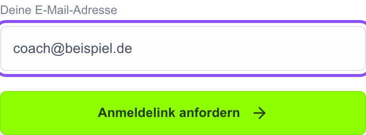
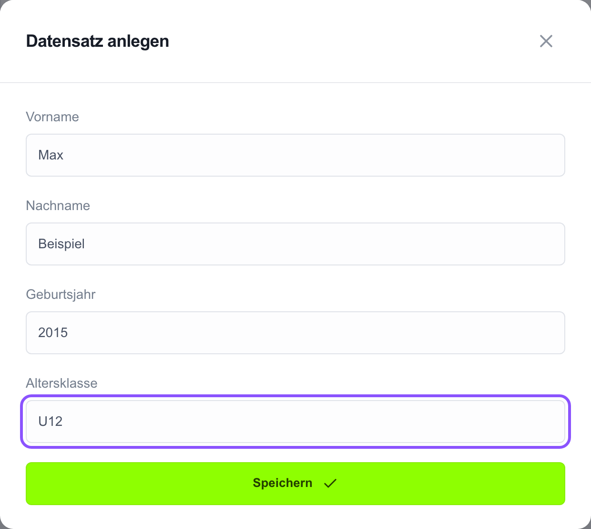
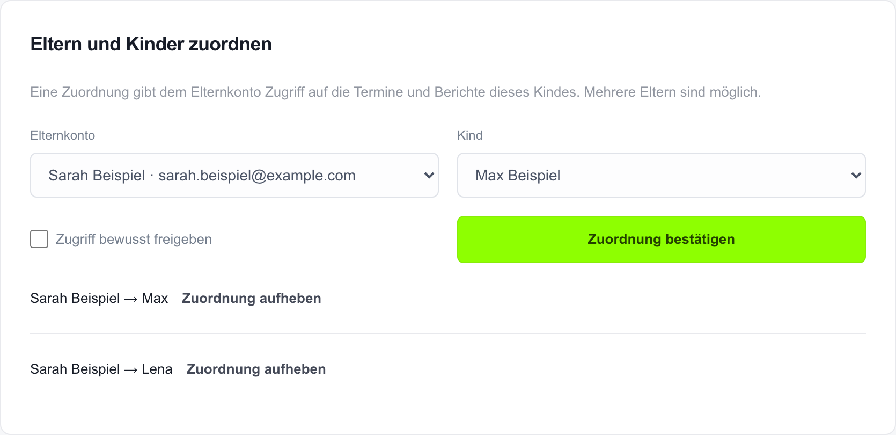
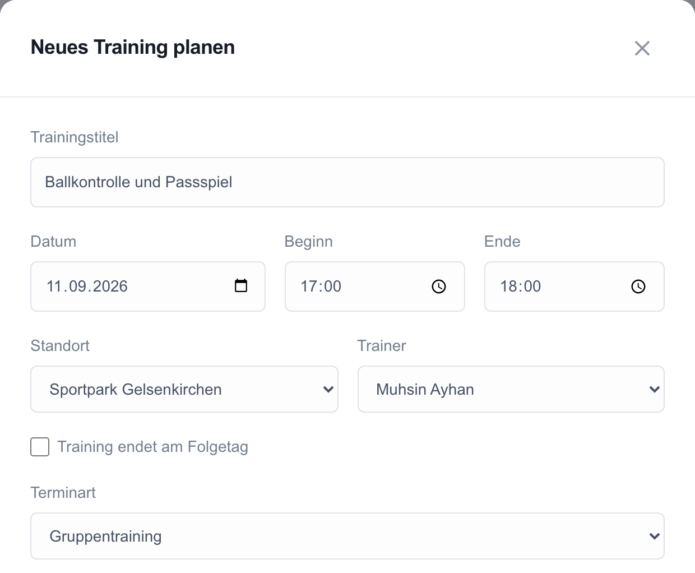
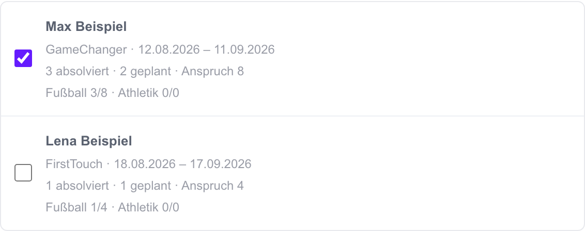
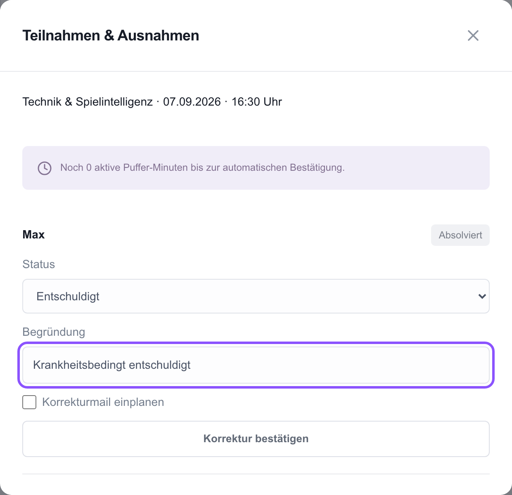
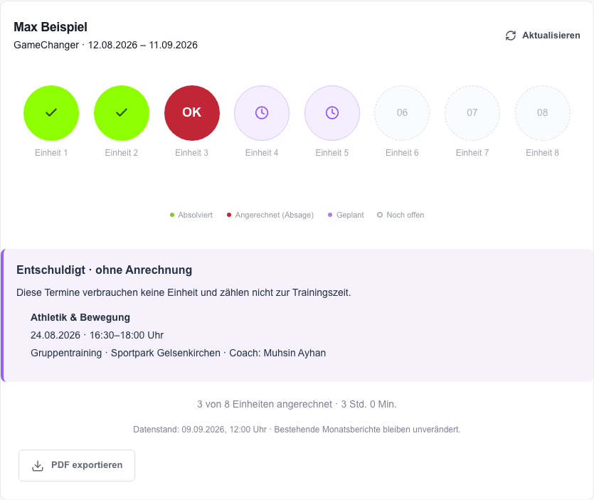

# ProAcademy Benutzerhandbuch

Stand: 10.09.2026. Für Coaches, Mitarbeiter und Admins.

[PDF öffnen](ProAcademy-Benutzerhandbuch.pdf)

## 1. Das Portal einfach bedienen

BENUTZERHANDBUCH

Für Coaches, Mitarbeiter und Admins. Schritt für Schritt durch die wichtigsten Aufgaben.

[Portal öffnen](https://proacademy-portal.proacademy-by-ak.workers.dev)

### Hier findest du schnell die richtige Seite

**Anmelden und orientieren** · Seiten 2-3
**Kinder und Eltern vorbereiten** · Seiten 4-6, nur Admin
**Trainings planen und bearbeiten** · Seiten 7-11
**Stempelkarten, E-Mails und Berichte** · Seiten 12-14
**Hilfe und tägliche Checkliste** · Seiten 15-16

> **Aktueller Testbetrieb, Stand 10.09.2026:** Automatische Bestätigungen, Berichte und Benachrichtigungen laufen noch nicht selbstständig. Login-Mails funktionieren. Versandaufträge bleiben bis zur Freigabe ausstehend.

Die Bilder zeigen Beispieldaten. Namen und Termine können bei dir anders aussehen. Die Anleitung beschreibt den veröffentlichten Stand der Webapp.

## 2. Zum ersten Mal anmelden

COACH + ADMIN

1. Öffne die Einladung von ProAcademy in deinem E-Mail-Postfach. Nutze den Link zum Portal.

2. Trage auf der Anmeldeseite genau die E-Mail-Adresse ein, für die du eingeladen wurdest. Klicke auf **„Anmeldelink anfordern“**.

3. Öffne die neue Login-Mail. Öffne den persönlichen Link **auf demselben Gerät und im selben Browser**, in dem du ihn angefordert hast.

> Du brauchst kein Passwort. Der Anmeldelink ist persönlich und nur einmal gültig. Auf der Anmeldeseite steht derzeit „Elternportal“; dieselbe Anmeldung gilt auch für Coach und Admin.

Keine Mail gefunden? Prüfe auch Spam und die Postfachansicht „Wichtiges“. Weitere Hilfe: Seite 15.

## 3. Menü und eigene Rolle

COACH + ADMIN

Nach der Anmeldung öffnet sich dein eigener Bereich. Welche Menüpunkte du siehst, hängt von deiner Rolle ab.

### Wer übernimmt welche Aufgabe?

| Aufgabe | Coach | Admin |
| --- | --- | --- |
| Trainings planen und korrigieren | Ja | Ja |
| Alle Stempelkarten ansehen / PDF exportieren | Ja | Ja |
| Stempelkarten-Mail vormerken | Ja | Ja |
| Kinder und Elternkonten verwalten | Nein | Ja |
| Abo-Zuordnung und Monatsberichte verwalten | Nein | Ja |

> Auf dem Handy öffnest du das Menü mit dem Symbol aus drei Strichen. Mit dem Pfeil-Symbol an der Seitenleiste klappst du das Menü ein oder aus.

Du siehst keine Links in fremde Rollenbereiche. Wenn dir eine Admin-Funktion fehlt, wende dich an die Leitung. Zum Beenden auf **„Abmelden“** klicken.

## 4. Ein Kind neu anlegen

NUR ADMIN

Ein neues Kind wird einmal als Spieler angelegt. Vorher über die Suche prüfen, ob es bereits vorhanden ist.

1. Öffne **„Spieler & Eltern“**. Klicke auf **„Neu anlegen“**.

2. Trage **Vorname, Nachname, Geburtsjahr und Altersklasse** ein. Beispiel: Max Beispiel, 2015, U12.

3. Klicke auf **„Speichern“**. Prüfe danach den neuen Eintrag in der Liste.

> Das Anlegen des Kindes allein reicht noch nicht für ein Training. Das Kind braucht zusätzlich einen passenden Leistungszeitraum aus der Abo-Zuordnung. Die Zuordnung zum Elternkonto folgt auf Seite 5.

## 5. Eltern und Kind verbinden

NUR ADMIN

1. Öffne **„Spieler & Eltern“ → „Eltern verwalten“**. Falls nötig, lege das Elternkonto über „Neu anlegen“ mit Name und Kontakt-E-Mail an.

2. Gehe zum Abschnitt **„Eltern und Kinder zuordnen“**.

3. Wähle das richtige **Elternkonto** und das richtige **Kind**. Prüfe beide Namen und die Kontakt-E-Mail sorgfältig.

4. Setze den Haken bei **„Zugriff bewusst freigeben“**. Klicke auf **„Zuordnung bestätigen“**.

> Diese Zuordnung gibt dem Elternkonto Zugriff auf die Daten dieses Kindes. Mehrere Eltern können demselben Kind zugeordnet sein. Eine falsche Zuordnung kann über „Zuordnung aufheben“ mit Begründung entfernt werden.

Das ist etwas anderes als ein Kind einem Training zuzuordnen. Die Auswahl der Trainingsteilnehmer steht auf Seite 8.

## 6. Abo und Einladung vorbereiten

NUR ADMIN · NACH FREIGABE

Der **Leistungszeitraum** legt fest, in welchem Zeitraum und mit welchem Kontingent das Kind trainieren kann. Er ist nicht immer ein Kalendermonat.

1. Öffne **„Stripe-Zuordnung“**. Über den derzeit so benannten Button **„Testkunden laden“** werden Kunden aus der eingerichteten Stripe-Umgebung geladen.

2. Beim richtigen Kunden auf **„Zuordnen“** klicken. Prüfe Elternname, bestätigte Kontakt-E-Mail und Kind.

3. Die passende **Stripe-Abonnement-ID** und **Stripe-Abonnement-Item-ID** müssen eindeutig feststehen. Bei Unklarheit die Leitung hinzuziehen; keine Kennungen schätzen.

4. Setze den Prüf-Haken und klicke auf **„Zuordnen & Einladung einplanen“**. Danach kontrollieren, ob beim Kind der richtige Leistungszeitraum erscheint.

### Bestehendes Elternkonto erneut einladen

Unter **„Einladungen“** kann ein Admin mit der vorhandenen Eltern-ID eine Einladung einplanen. Die Eltern-ID ist eine technische Kennung und muss von der Leitung bereitgestellt werden, wenn sie nicht bekannt ist.

> **Im aktuellen Test:** Kundenimport und echte Elterneinladungen erst nach ausdrücklicher Freigabe der Leitung. Der Buttonname „Testkunden laden“ bedeutet nicht, dass die eingerichtete Stripe-Umgebung ein Testkonto ist.

**Mitarbeiter-Einladung:** Neue Coach-Zugänge richtet derzeit die Leitung ein. Das Formular „Einladungen“ ist für Eltern bestimmt; ein einfacher Coach-Einladungsdialog ist für V2 vorgemerkt.

## 7. Ein Training planen

COACH + ADMIN

1. Öffne **„Trainingsplanung“**. Wähle den Tag oder die Woche und klicke auf **„Termin erstellen“**.

2. Prüfe **Trainingstitel, Datum, Beginn und Ende**. Alle angezeigten Trainingszeiten gelten für Deutschland: Europe/Berlin.

3. Wähle **Standort, Trainer und Terminart**. Nutze „Athletiktraining“ nur, wenn das passende Kontingent vorhanden ist.

> Das Ende muss nach dem Beginn liegen. „Training endet am Folgetag“ brauchst du nur bei einem tatsächlichen Termin über Mitternacht. Danach die Kinder auswählen: Seite 8.

## 8. Kinder zum Training auswählen

COACH + ADMIN

Im geöffneten Termin findest du den Abschnitt **„Kinder zuordnen“**.

1. Suche das Kind nach seinem Namen. Setze bei jedem teilnehmenden Kind einen Haken. Ein Termin kann mehrere Kinder enthalten.

2. Prüfe unter dem Namen den Leistungszeitraum und die Angaben **„angerechnet“, „geplant“ und „Anspruch“**.

3. Ergänze bei Bedarf eine **„Interne Notiz“**. Sie ist nur für das Team sichtbar und gehört nicht in Elternmails oder Stempelkarten-PDFs.

4. Entscheide über **„Eltern per E-Mail benachrichtigen“**. Mit Haken wird eine Planungsnachricht vorgemerkt.

5. Klicke auf **„Termin speichern“**. Warte auf die Rückmeldung und prüfe den Termin anschließend in der Übersicht.

> Fehlt ein passender Leistungszeitraum, lässt sich der Termin nicht speichern. Prüfe Datum und Trainingsart. Der Admin prüft anschließend die Abo-Zuordnung. Nicht einfach einen anderen Zeitraum oder ein anderes Kind auswählen.

## 9. Termin ändern oder absagen

COACH + ADMIN

### Einen bestehenden Termin ändern

1. Suche den Termin in **„Trainingsplanung“**. Klicke auf **„Termin bearbeiten“** oder auf den Trainingstitel.

2. Ändere die erforderlichen Angaben. Prüfe Datum, Uhrzeit, Standort, Trainer und die ausgewählten Kinder.

3. Prüfe den Haken für die Elternbenachrichtigung. Mit Haken wird bei einem bestehenden Termin eine Änderungsnachricht vorgemerkt. Klicke auf **„Termin speichern“**.

### Den gesamten Termin absagen

1. Öffne **„Termin bearbeiten“ → „Termin stornieren“**.

2. Trage einen verständlichen **Stornierungsgrund** ein und klicke auf **„Stornierung bestätigen“**.

> Eine Termin-Stornierung betrifft alle zugeordneten Kinder. Fehlt nur ein einzelnes Kind, nutze „Ausnahmen eintragen“ statt den gesamten Termin zu stornieren.

Bei bereits angerechneten Teilnahmen sind Änderungen an Zeit oder Trainingsart zunächst gesperrt. Die betroffene Teilnahme muss zuerst begründet korrigiert werden. Bei Unsicherheit die Leitung hinzuziehen.

Der Verlauf bleibt erhalten. Eine Absage löscht den Termin nicht unsichtbar aus der Dokumentation.

## 10. Teilnahme und Ausnahmen

COACH + ADMIN

Reguläre Teilnahme wird im freigegebenen Betrieb automatisch bestätigt. Fehlende oder abweichende Teilnahme trägst du als Ausnahme ein.

1. Beim richtigen Termin auf **„Ausnahmen eintragen“** klicken.

2. Beim richtigen Kind den **Status** auswählen, etwa „Entschuldigt“, „Nicht erschienen“ oder „Absolviert (manuell)“.

3. Eine verständliche **Begründung** eintragen. Bei Bedarf **„Korrekturmail einplanen“** auswählen und **„Korrektur bestätigen“** klicken.

> Ein zukünftiges Training darf nicht als absolviert bestätigt werden. Wird eine bisher offene Teilnahme als absolviert bestätigt, entsteht eine Abschlussmail auch ohne Haken bei der Korrekturmail.

## 11. Was zählt als Stempel?

COACH + ADMIN

| Status | Einheit / Trainingszeit |
| --- | --- |
| Absolviert / Absolviert (manuell) | Ja / Ja |
| Geplant | Nein / Nein |
| Entschuldigt | Nein / Nein |
| Nicht erschienen | Ja, rotes OK / Nein |
| Abgesagt / Storniert | Ja, rotes OK / Nein |

### Automatische Bestätigung verstehen

Nach dem Trainingsende laufen **12 aktive Pufferstunden**. Zwischen 00:00 und 06:00 Uhr pausiert diese Zeit. Beispiel: Ende am Dienstag um 18:00 Uhr → Frist am Mittwoch um 12:00 Uhr. Die Bestätigung erfolgt beim nächsten aktiven Hintergrundlauf.

### Ein vergangenes Training nachtragen

Du kannst einen vergangenen Termin anlegen, wenn ein passender Leistungszeitraum vorhanden ist. Er startet zunächst als „geplant“. Ist die Frist schon vorbei, kann der nächste aktive Hintergrundlauf ihn als absolviert bestätigen.

> Eine Nachtragung kann eine Planungsmail und danach eine Abschlussmail erzeugen. Ein bereits vorhandener Monatsbericht ändert sich dadurch nicht automatisch. Informiere den Admin, wenn ein Bericht betroffen ist.

**Aktueller Testbetrieb:** Der Hintergrundlauf ist deaktiviert. Automatische Bestätigungen erfolgen deshalb derzeit nicht von allein. Gezielte Tests werden mit der Leitung abgestimmt.

## 12. Stempelkarte ansehen und exportieren

COACH + ADMIN

1. Öffne **„Stempelkarten“**. Suche das Kind und wähle den gewünschten **Leistungszeitraum**.

2. Prüfe die Farben: **Grün = teilgenommen**, **rotes OK = Absage / nicht erschienen**, **Lila = geplant**, **hell = offen**. Darunter steht die Trainingsübersicht. Fußball und Athletik werden bei passenden Tarifen getrennt angezeigt.

3. Mit **„Aktualisieren“** lädst du den aktuellen Stand. Mit **„PDF exportieren“** wird die Stempelkarte heruntergeladen.

> Das PDF findest du meist im Ordner „Downloads“. Es zeigt den Stand zum Exportzeitpunkt. Bestehende Monatsberichte werden dadurch nicht verändert.

## 13. Stempelkarte per E-Mail

COACH + ADMIN

1. Öffne die richtige Stempelkarte wie auf Seite 12. Prüfe Kind und Leistungszeitraum.

2. Gehe zum Abschnitt **„Stempelkarte per E-Mail“**. Wähle unter **„Empfänger auswählen“** das richtige Elternkonto.

3. Klicke auf **„Per E-Mail vormerken“**. Prüfe in der Rückfrage die Zieladresse und bestätige den Versandauftrag.

> Zur Auswahl stehen nur Elternkontakte, die diesem Kind zugeordnet sind. Es gibt kein freies Adressfeld. Fehlt der richtige Kontakt, muss der Admin zuerst die Zuordnung prüfen.

### „Vorgemerkt“ bedeutet noch nicht „angekommen“

Die App speichert einen Versandauftrag mit dem Datenstand zum Zeitpunkt der Anforderung. Der Hintergrunddienst erstellt daraus das PDF und verarbeitet die Mail später.

**Aktueller Test:** Die Zieladresse ist auf die konfigurierte Testadresse begrenzt. Sie wird in der Ansicht angezeigt. Der Hintergrunddienst ist deaktiviert; neue Aufträge bleiben ausstehend.

Nach Freigabe des regulären Versands wird die Nachricht an den zugeordneten Elternkontakt verarbeitet. Vor dem Versand wird die Zuordnung erneut geprüft.

Bei einer Elternnachfrage den Admin um Prüfung unter **„Protokolle & Berichte“** bitten. Nicht mehrfach klicken, nur weil die Mail noch nicht im Postfach liegt.

## 14. Monatsberichte und Versand prüfen

NUR ADMIN

Öffne **„Protokolle & Berichte“**. Hier unterscheidest du zwischen PDF-Berichten und Versandaufträgen.

### Im Reiter „PDF-Berichte“

| Aktion | Bedeutung |
| --- | --- |
| PDF öffnen | Vorhandenen Bericht ansehen. |
| Erneut senden | Dasselbe vorhandene PDF erneut zum Versand vormerken. |
| Neue Version | Einen neuen Bericht mit aktuellem Datenstand anfordern. Die alte Version bleibt erhalten. |

Ein Monatsbericht gehört zu einem abgeschlossenen Leistungszeitraum. Ein später nachgetragenes oder korrigiertes Training verändert das vorhandene PDF nicht automatisch. Prüfe, ob eine **neue Version** erforderlich ist.

### Im Reiter „E-Mail-Aufträge“

**pending:** wartet auf Verarbeitung.
**processing:** wird verarbeitet.
**sent:** Versand wurde protokolliert; Postfacheingang bei Bedarf bestätigen lassen.
**failed / uncertain:** Fehler oder unklarer Ausgang; zuerst Versandhistorie und Leitung prüfen lassen.

> „Nach Prüfung wiederholen“ erst verwenden, wenn geklärt ist, dass die Nachricht nicht zugestellt wurde. Bei unklarem Ausgang nicht blind erneut senden.

Coaches haben keinen Zugriff auf diese Admin-Berichte. Für Elternfragen können sie die Stempelkartenansicht und deren PDF-Export nutzen.

## 15. Wenn etwas nicht klappt

COACH + ADMIN

### Die Login-Mail fehlt

Adresse auf Tippfehler prüfen. Auch Spam und „Wichtiges“ ansehen. Im Testbetrieb muss die eigene Adresse freigegeben sein. Wenn nötig, die Leitung kontaktieren.

### Der Link führt wieder zur Anmeldung

Fordere einen neuen Link an. Öffne ihn im selben Browser und auf demselben Gerät. Alte Links sind möglicherweise bereits verbraucht. Einen neuen Link nicht zwischen verschiedenen Browsern hin- und herwechseln.

### Das Kind fehlt oder lässt sich nicht buchen

Suche zurücksetzen und Namen prüfen. Datum, Leistungszeitraum und Trainingsart kontrollieren. Der Admin prüft Kind, Elternzuordnung und Abo-Zuordnung.

### Der Stempelstand scheint falsch

Kind und Zeitraum prüfen. Absagen zählen als Einheit, aber ohne Trainingszeit. Entschuldigungen erscheinen mit Termindaten unter „Entschuldigt · ohne Anrechnung“ und im PDF.

### Die E-Mail ist vorgemerkt, kommt aber nicht an

Im aktuellen Testbetrieb ist das erwartet, solange der Hintergrunddienst deaktiviert ist. Der Admin prüft den Auftrag. Eine vorgemerkte Mail ist keine Zustellbestätigung.

> Für eine Rückfrage bereithalten: Name des Kindes, Trainingstag, Uhrzeit, gewünschte Aktion und genaue Fehlermeldung. Einen Screenshot nur über den vereinbarten internen Weg teilen. Persönliche Anmeldelinks nicht weitergeben.

## 16. Die kurze Alltags-Checkliste

COACH + ADMIN

### Vor dem Training

- [ ] Mit dem eigenen Konto angemeldet.

- [ ] Richtiger Tag, Uhrzeit, Standort und Trainer geprüft.

- [ ] Die richtigen Kinder ausgewählt und Leistungszeitraum geprüft.

- [ ] Termin gespeichert und in der Übersicht kontrolliert.

### Nach dem Training

- [ ] Fehlende Kinder und andere Ausnahmen eingetragen.

- [ ] Bei Korrekturen eine verständliche Begründung angegeben.

- [ ] Benachrichtigung bewusst geprüft; im Test nichts als zugestellt vorausgesetzt.

### Bei einer Elternfrage

- [ ] Stempelkarte mit richtigem Kind und Zeitraum geöffnet.

- [ ] Trainingsübersicht und Teilnahmestatus geprüft.

- [ ] Bei Bedarf PDF exportiert oder Mailauftrag vorgemerkt.

- [ ] Admin informiert, wenn Abo, Elternzugriff oder Monatsbericht betroffen ist.

> **Merksatz:** Erst Kind und Zeitraum prüfen. Dann ändern, speichern und die Rückmeldung kontrollieren.

Auf gemeinsam genutzten Geräten zum Schluss **abmelden**. Dieses Handbuch kannst du ausdrucken oder als PDF auf dem Handy speichern.

---

Pflege: Inhalte in `docs/handbuch/inhalte.json`, Bildschirmbilder in `docs/handbuch/bilder/`. PDF und Textfassung mit `python3 scripts/create-handbook.py` neu erstellen. Änderungen am Handbuch veröffentlichen keine App-Version.
